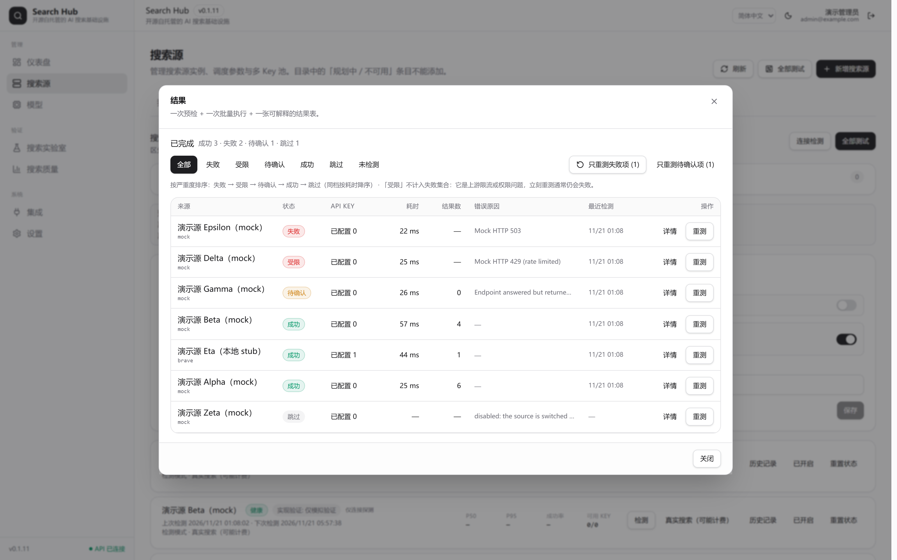
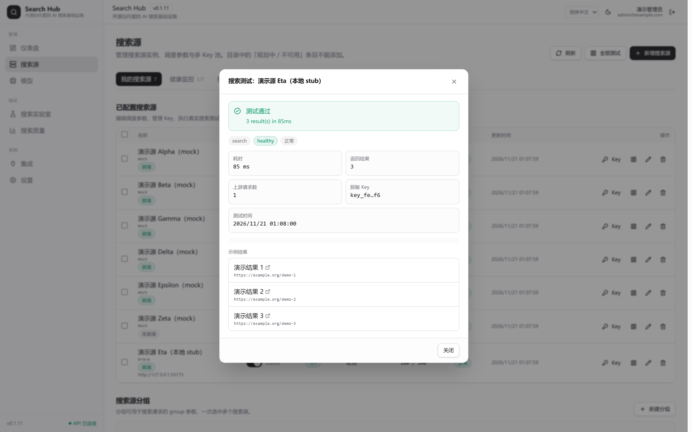

# Search Hub

**自托管的 AI 聚合搜索基础设施。** 一套服务，聚合多个搜索源，管理多组 API Key，输出统一结果，并通过 REST API、MCP、Agent Skills 与独立 CLI `shub` 同时对外提供能力。

[English](./README_EN.md) · [架构](./docs/architecture.md) · [部署](./docs/deployment.md) · [API](./docs/api.md) · [MCP](./docs/mcp.md) · [Skills](./docs/skills.md) · [旧版迁移](./docs/legacy-migration.md) · [测试](./docs/testing.md) · [验收矩阵](./docs/ac-matrix.md) · [验收报告](./docs/acceptance-report.md) · [发布就绪](./docs/release-readiness.md) · [真实联调方案](./docs/real-search-validation-plan.md) · [能力清单](./docs/capability-inventory.md) · [远端验收](./docs/github-remote-acceptance-plan.md) · [Provider 开发](./docs/provider-plugin-guide.md)

> **状态：v0.1.15 · 候选版本，发布门禁执行中。**
>
> **v0.1.15 主题**：age/tar 完整灾备包、六项恢复验证、默认 dry-run 的隔离恢复、失败升级整目录回滚，以及绑定最终代码指纹的发布证据链。M04 性能门槛与完整回归结果以 `docs/release-readiness.md` 的实际记录为准，未执行项保持 PENDING/BLOCKED。
>
> **上一 Stable**：v0.1.13 已发布，包含独立 `shub` CLI；历史验收、资产、Provenance 与 GHCR 证据保留在 `docs/release-readiness.md`。
>
> **Stable 的含义是「这是维护者当前选择的公开正式发布渠道」，不是「所有外部集成均已通过生产认证」。** 具体说：**Hacker News、Crossref、OpenAlex、PubMed 已完成真实网络联调**；Tavily / 博查 Bocha / Brave / SearXNG 等其余适配器按官方文档实现，**尚未完成真实搜索联调**；搜索质量评测目前只有合成基准，**没有真实厂商标注集**。这些缺口在 [Provider 状态矩阵](./docs/provider-matrix.md)、[发布就绪报告](./docs/release-readiness.md) 与 [CHANGELOG](./CHANGELOG.md) 里逐项列明，未联调的能力不会被描述为“已验证”。

---

## 它解决什么问题

单个搜索 API 会遇到三个问题：额度单点、故障单点、结果单一。自己写聚合脚本又要重复处理 Key 轮换、限速、去重、融合和对外协议。

Search Hub 把这些做成一个可部署的服务：

- **多源并发**：一次查询同时发给多个搜索源，单源失败不影响整体，返回部分成功结果与失败原因。
- **Key 池**：同一搜索源可配置任意多个 Key，支持轮询、随机、加权随机、最少使用、故障切换；每 Key 独立并发、RPM、日配额、冷却与熔断。
- **统一结果**：URL 规范化、精确/近似去重、RRF 融合，保留每个结果的命中来源与原始排名。
- **四个入口，一套核心**：REST、MCP、Agent Skills 与 CLI 都调用同一个服务端搜索核心；CLI 只是远程 HTTP 客户端，不存在第二套实现。
- **可选智能增强**：AI 摘要（带 `[n]` 引用）、Embedding 语义重排、Rerank。未配置模型时普通搜索完全可用。

## 核心能力

| 能力 | 状态 | 说明 |
|---|---|---|
| 多源并发搜索 + 部分成功 | 已实现 | 单源超时、全局 deadline、独立错误隔离、客户端取消 |
| Key 池调度（5 种策略） | 已实现 | 原子占额 + 有界等待队列；100 并发下每 Key 并发 / RPM / 日配额均不被突破 |
| 429 / 401 / 5xx 差异处理 | 已实现 | 429 按 `Retry-After` 冷却；401/403 暂停 Key；5xx 指数退避 + 熔断 |
| URL 规范化 + 去重 + RRF | 已实现 | 保留全部来源；RRF k 可配，默认 60 |
| 管理后台（浅/深色、中英双语） | 已实现 | 仪表盘、搜索源、Key、模型、搜索实验室、集成、设置与日志；header 语言切换，选择持久化 |
| REST API + OpenAPI 3.1 | 已实现 | `/api/openapi.json` 与 `/api/docs` |
| MCP Server | 已实现 | 2026-07-28 现代协议 + 2025-11-25 传统握手；Streamable HTTP + stdio |
| Agent Skills | 已实现 | 3 个 `SKILL.md`，遵循 agentskills.io 结构 |
| CLI `shub` | 已实现 | 独立 Windows/Linux 可执行包与 Node 22 便携包；搜索、深度搜索、来源、状态、诊断、配置与健康检测；JSON/NDJSON 纯净输出 |
| AI 摘要 / Embedding / Rerank | 已实现（可选） | OpenAI 兼容 / Anthropic / Gemini / Cohere-Jina 兼容 / custom-http |
| 结果缓存（SQLite 持久化） | 已实现 | 1–72 小时可配；重启/容器重建后仍有效；容量上限自动 LRU 淘汰，后台每 10 分钟清理过期 |
| 中英文界面 | 已实现 | zh-CN 为默认，en-US 完整覆盖；语言选择持久化，日期/数字跟随语言 |
| 搜索质量评测实验室 | 已实现 | 人工相关性标注（四级）+ P@10 / Recall@10 / MRR@10 / nDCG@10；离线基准不联网、可复现；单源/基础/RRF 对比；RRF 参数实验用 development/holdout 隔离；标注不足输出 N/A 与 INSUFFICIENT_EVIDENCE |
| 搜索源健康管理中心 | 已实现 | 实现验证状态与运行状态分离；连接探测按物理 HTTP 跳数计量预算（默认单次 5 / 每日 50）；真实搜索探测会消耗额度，默认关闭；所有探测路径共用同源 in-flight 锁；预算持久化且并发安全；指数退避自动恢复；单源开关与重置 |
| PostgreSQL | 未实现 | 当前仅 SQLite；接口已隔离，见[已知限制](#已知限制) |
| Redis 多实例协调 | 未实现 | 单进程额度保证；多实例方案见架构文档 |

### 搜索源健康管理中心

「配置了」和「能用」是两件事，这个页面把它们分开：

| 维度 | 说明 |
|---|---|
| 实现验证 `documented` / `mock_verified` / `live_tested` / `unverified` | 这个适配器当初怎么被验证的。**一次探测成功不会升级它** |
| 运行状态 `healthy` / `degraded` / `rate_limited` / `quota_exceeded` / `invalid_credentials` / `permission_denied` / `cooldown` / `unknown` / `unverified` / `disabled` | 这个实例现在能不能用 |

- **两种探测**：连接探测按解析后的最小搜索计划执行，分页与重定向的每个物理 HTTP 跳都计入独立连接预算；对需要凭证的源，请求同样带凭证，所以不宣称"一定免费"。真实搜索探测会调用厂商搜索接口，只有它拿到结果才能说"现在能搜到"。完全无需凭证的源（HN / Crossref / OpenAlex / PubMed / arXiv / Wikipedia）可以不经付费开关直接做真实搜索验证，并单独计数。
- **预算**：付费真实搜索、匿名真实搜索与连接探测分别计数。付费/匿名默认均为每轮 3 次、每日 20 次；连接探测默认单次最多 5 个物理 HTTP 跳、每日 50 跳（均可调，有硬上限）。计数存在数据库里，重启不重置，并发探测也不会突破；写不进账本就不发请求。请求数不等于厂商账单，`billingUnit` 明确为 `unknown`。
- **同源去重**：单源测试、Key 测试、定时巡检、全部测试与批量任务共用同一个 in-flight 锁。重复探测返回 `409 already_running`，批量任务把它记为跳过，不会重复请求或误报源失败。
- **本地预算拒绝**：连接预算超限返回 `429 quota_exceeded`，不写健康结论、不失效 Key、不停用源；批量任务记 `SKIPPED_BUDGET`。GET 预检、概览、设置与 MCP 健康读取均不写数据库。
- **自动恢复**：瞬时失败按指数退避尽快重试，终态失败等正常间隔；一次失败永远不会永久
  禁用一个源，恢复后自动回到 `healthy`。
- **默认关闭**：后台定时探测默认不开启，开启后才按间隔与预算运行。
- **需要凭据但没有可用凭据的源不会显示健康**；完全免 Key 的公开源可以正常探测并显示真实运行状态。

#### 一键批量检测

单个来源可以「测试」，全部来源可以「全部测试」。「全部测试」在**搜索源页面顶部**和健康 tab 各有一个入口，打开的是同一个预检流程。批量检测分三步，每一步都能看清再决定：

| 步骤 | 你能看到什么 |
|---|---|
| **预检** | 6 个计数（可测 / 无 Key / 配置错误 / 已禁用 / 免 Key 跳过 / 冷却、额度与策略跳过）+ 付费/匿名额度 + 是否可能产生第三方费用。七项之和等于范围内来源总数，不会有来源被悄悄漏掉 |
| **执行** | 实时进度（`已完成/待检测`、百分比、当前来源）、成功 / 失败 / 待确认 / 跳过四个计数，以及取消按钮 |
| **结果** | 8 列结果表：来源（名称 + 适配器类型）/ 状态 / API Key（已配置数量）/ 耗时 / 结果数量 / 错误原因 / 最近检测 / 操作（详情、单行重测）；按严重度排序（失败 → 受限 → 待确认 → 成功 → 跳过）、可筛选、可「只重测失败项」。详情抽屉给分类、建议、实测上游请求数与最多 3 条样例 |

- **默认只测已配置 Key 的来源**：没有凭据的源被标为「无 Key」跳过，不计入失败，也不进成功率分母。
- **免 Key 来源默认跳过**：预检框里打开的「包含免 Key 来源（仅本次任务）」只影响当前任务，不修改全局设置，也不会改变刷新后恢复的任务快照；它们是真实搜索，会向第三方发请求。
- **跳过不等于失败**：被跳过的源不会写健康结论，也不会出现在「重测失败」集合里。
- **付费提示**：预检分别显示潜在付费探测与匿名探测数量。付费检测关闭时，纯付费范围会禁用开始并说明原因；混合范围只跳过需凭据源，匿名源继续，不会整批拒绝。
- **取消可回读**：取消后已完成的结论仍然可读，未开始的部分标为「已取消」。
- **重启不撒谎**：进程在检测中途被杀，任务状态是 `interrupted`（部分完成），永远不会显示成「全部完成」。
- **刷新可回看**：开始检测后浏览器记住一个任务指针，刷新页面会在标签栏上方显示「上次检测仍在进行（已完成 x/共 y）」或「上次检测已结束（部分完成）」，点一下直接回到进度或结果；任务已不存在或属于别的账号时静默清除，不报错。
- **未测量的字段显示 `—`**：没发过请求就没有耗时、结果数和请求数，不用 0 冒充一次测量；也没有任何地方会显示 API Key 明文。

[](docs/screenshots/v0111/provider-batch-test.png)

[](docs/screenshots/v0111/provider-test.png)

详见 [docs/provider-health.md](./docs/provider-health.md)。

## 搜索质量评测

「哪个源结果更好」不再靠感觉：固定数据集 + 人工相关性标注 + 可复现指标。

- **四级标注**：0 不相关 / 1 弱相关 / 2 部分回答 / 3 充分回答；二元指标以 ≥2 为相关。
  AI 生成的标注单独记 `machine_generated`，不会冒充人工真值。
- **未标注 ≠ 不相关**：未标注文档默认被排除在指标之外，查询标记为 provisional；
  没有标注就返回 **N/A**，而不是 0 分。标注不完整时 Recall 明确显示 N/A。
- **两种模式**：`offline` 读快照或内置合成基准，**不联网、不消耗额度**；`live` 走与用户
  搜索同一条链路（同 Key 池、同调度器、同 SSRF 与健康门禁），必须显式选源、设置请求上限
  并确认可能产生费用，最坏情况（查询 × 源 × 2 次尝试）超出预算时**一个请求都不发**。
- **公平对比**：用 `snapshotRunId` 对**同一批原始结果**重新排序，而不是拿昨天和今天的两份
  搜索结果比高低。数据集版本不同直接拒绝比较。
- **RRF 离线优化**：只比较 k = 20/40/60/80/100 与固定源权重，参数在 development 上选、
  在 holdout 上评价；证据不足输出 **INSUFFICIENT_EVIDENCE**。线上默认仍是 k=60，本轮不改。
- **CI 门禁**：`pnpm quality:eval` 先跑 11 项手算自检，再与提交的基线比 nDCG@10，
  下降超过阈值即失败。合成基准的分数只证明机制正确，**不是任何厂商的检索质量**。

详见 [docs/search-quality.md](./docs/search-quality.md)。

## 支持的搜索源

**已实现适配器（50 类）**

| 类型 | 鉴权 | 说明 | 验证状态 |
|---|---|---|---|
| `exa` | API Key | Exa Search，`POST /search`，标量结果+正文摘要，单次上限 100 | 按官方文档实现；**无真实 Key，未联调** |
| `firecrawl` | API Key | Firecrawl Search，`POST /v2/search`，`data.web[]` | 按官方文档实现；**无真实 Key，未联调** |
| `serper` | API Key | Serper.dev Google SERP，`organic[]`，支持 `page` 分页 | 按官方文档实现；**无真实 Key，未联调** |
| `github` | 可选 Token | GitHub 搜索（仓库/Issue/代码），垂直索引 | 按官方文档实现；**未联调** |
| `arxiv` | 无 | arXiv Atom API，学术预印本垂直索引 | 按官方文档实现；**未联调** |
| `minimax` | API Key | MiniMax Coding Plan `web_search`：`POST /v1/coding_plan/search`，`organic[]`；错误按 `base_resp` 判定（1004 区域不匹配 / 2038 无权限） | 协议取自官方 MCP 源码；**无 Coding Plan 凭证，未联调** |
| `metaso` | API Key | 秘塔搜索：`POST https://metaso.cn/api/v1/search`，`webpages[]` | 路径与错误码经真实请求确认（2005=密钥无效）；**无 Key，成功响应未实测** |
| `metaso-mcp` | 无 | 已部署的秘塔 MCP 服务（Streamable HTTP，默认 127.0.0.1:44454） | 复用 Generic MCP，预置 q/webpages 映射；不主动连接旧实例 |
| `gemini` | API Key | Gemini generateContent + `google_search` 工具，返回 `groundingChunks` 引用；未联网时明确标记 | 按官方文档实现；**无真实 Key，未联调** |
| `grok` | API Key | xAI Responses API + `web_search`，要求存在 `web_search_call` 才算联网 | 按官方文档实现；**无真实 Key，未联调** |
| `mimo` | API Key | 小米 MiMo `tools:[{type:"web_search"}]`，引用在 `annotations` | 按官方文档实现；**无真实 Key，未联调** |
| `bailian` | API Key | 百炼 DashScope 原生联网（兼容通道拿不到来源），返回 `search_results` | 按官方文档实现；**无真实 Key，未联调** |
| `stepfun` | API Key | 阶跃独立 `/v1/search`（文档明确部分模型不支持内置 web_search） | 按官方文档实现；**无真实 Key，未联调** |
| `tencent-yuanbao` | SecretId + SecretKey（凭证对） | 腾讯云元宝搜索 SearchPro，TC3-HMAC-SHA256 签名；`Cnt` 只接受 10/20/30/40/50 | 按官方文档实现；**无真实凭证，未联调** |
| `doubao` | API Key | 火山豆包联网搜索 Custom，字段为大驼峰；额度错误不会误判成 Key 失效 | 按官方文档实现；**无真实 Key，未联调** |
| `deepseek-search` | API Key | DeepSeek 独立结构化搜索 `POST /v1/tools/search`（不是 Chat Completion） | 按官方文档实现；**无真实 Key，未联调** |
| `qianfan-search` | API Key | 百度千帆 AI 搜索，真实网页在 `references[]`，支持 standard/turbo/pro | 按官方文档实现；**无真实 Key，未联调** |
| `anysearch` | 可选 | AnySearch 统一搜索，匿名可用（限流更严），`POST /v1/search` | 按官方 skill 契约实现；**未联调** |
| `tavily` | API Key | Tavily Search API，`POST /search` + `Authorization: Bearer` | 按官方文档实现；**无真实 Key，未联调** |
| `bocha` | API Key | 博查 Web Search API，`POST /v1/web-search`，中文网页覆盖较好 | 按官方文档实现；**无真实 Key，未联调** |
| `brave` | API Key | Brave Web Search API，`X-Subscription-Token` | 按官方文档实现；**无真实 Key，且当前网络不可达，未联调** |
| `hackernews` | 无 | HN Search 官方托管 API（Algolia），真实可访问的技术社区检索 | **已真实联调**（真实 URL、真实时间戳） |
| `searxng` | 可选 | 自建实例 `/search?format=json`，需启用 JSON 输出 | 按官方文档实现；**未对真实实例联调** |
| `generic-http` | 可配置 | 声明式映射 URL/Headers/Body/结果路径，覆盖长尾 API | 本地模拟服务测试通过 |
| `search-hub-legacy` | 可选 | 调用独立运行的旧版 Search Hub REST 接口；只读、可撤销，见[兼容接入](./docs/legacy-44475-integration.md) | 契约测试通过；**未连接真实旧实例** |
| `mock` | 无 | 确定性测试源，支持延迟与故障注入 | 自动化测试使用 |

**目录中没有实现、也无法创建的条目**：只有 `baidu`（百度搜索）——它没有可公开申请与验证的通用网页搜索 API，直接抓取 HTML 违反其条款，因此条目保留为说明用途。其余「兼容网关」类条目（Search Gateway、Premium、ORZ Fetch 等 7 个）是 `generic` 声明式预设，**可以创建**，只是需要你填入实际端点与结果路径。

> 目录共 58 条：50 个可用适配器、1 个无官方接口、7 个 generic 兼容入口。全新安装不含任何搜索源，需从市场添加。项目**不声称支持 58 个搜索源**——「在目录里」不等于「已验证可用」。逐源的实现方式与联调缺口见 [docs/provider-matrix.md](./docs/provider-matrix.md)。
>
> 三种状态严格区分：**已编码实现**（`builtin`，按官方协议写的适配器）／**模拟契约测试通过**（`mock_verified`，只证明代码路径正确，不碰真实厂商）／**真实厂商联调通过**（`live_tested`，有可复查的真实调用记录）。除 Hacker News、Crossref、OpenAlex、PubMed 外，其余适配器都属于「已编码实现」而非「已联调」。

## 下载安装（v0.1.15 候选）

v0.1.15 发布流程将生成以下资产；只有在 draft Release、资产摘要、Provenance、GHCR digest 与资源证据全部通过后才会转为 Stable。

| 平台 | 服务端 | CLI `shub` | 需要什么 |
|---|---|---|---|
| Windows x64 | `search-hub-v0.1.15-windows-x64.zip` | `shub-v0.1.15-windows-x64.zip` | **无** |
| Linux x64 | `search-hub-v0.1.15-linux-x64.tar.gz` | `shub-v0.1.15-linux-x64.tar.gz` | **无** |
| Linux arm64 | `search-hub-v0.1.15-linux-arm64.tar.gz` | `shub-v0.1.15-linux-arm64.tar.gz` | **无** |
| Node.js 22+ | — | `shub-v0.1.15-node22.tar.gz` | Node.js 22+ |

发布后从 [v0.1.15 Release](https://github.com/alicia1030su/search-hub/releases/tag/v0.1.15) 下载同一份 `SHA256SUMS` 并执行 `sha256sum -c SHA256SUMS`；`resource-evidence.json` 与七个归档都在摘要覆盖范围内。CLI 不需要部署服务端，可连接本机或远程 Search Hub。

### CLI 快速开始

```bash
export SEARCH_HUB_URL="https://search.example.com"
export SEARCH_HUB_TOKEN="sh_..."
shub search "Linux"
shub search "AI" --json
shub sources
shub status
shub doctor
```

PowerShell：

```powershell
$env:SEARCH_HUB_URL = "https://search.example.com"
$env:SEARCH_HUB_TOKEN = "sh_..."
.\shub.exe search "Linux"
.\shub.exe sources
```

Token 只从环境变量或 `--token-stdin` 读取，不写入明文配置。完整说明见 [docs/cli.md](./docs/cli.md)。

### v0.1.15 备份与灾备

管理后台新增 **备份中心**（`/backup`）：可下载 age 默认强度加密的完整 `.shbackup` 恢复包、兼容的 `.db` 快照，并上传 `.shbackup` 或 `.db` 校验。完整包包含清单、一致性数据库与 `master.key`；网页不显示密钥，也不提供原址恢复。浏览器下载采用流式写盘，不支持 File System Access API 时请使用 Chromium/Edge 或本地 CLI。

```bash
shub backup create --output search-hub.shbackup --passphrase-stdin
shub backup verify search-hub.shbackup --passphrase-stdin
# 默认 dry-run：只验证并展示计划，不写入目标目录
shub backup restore search-hub.shbackup --data-dir /srv/search-hub-restored --passphrase-stdin
# 确认 dry-run 报告后才显式应用
shub backup restore search-hub.shbackup --data-dir /srv/search-hub-restored --apply --start-check --passphrase-stdin
shub doctor --local
```

Bash、PowerShell、Docker Volume、systemd 与 nginx 超时可复制示例见 [灾备指南](./docs/disaster-recovery.md)。恢复只允许不存在或为空的目标目录。

> **v0.1.12 收口凭据泄漏与探测计量**：修复 URL query API Key 在 JSON/HTML/编码错误、错误 `details.url`、SQLite 健康历史、Key `last_error`、审计与 MCP 输出中的泄漏；单源、批量、Key 与定时探测统一 in-flight 锁，重复请求为 409 `already_running`；连接探测改为按物理 HTTP 跳计数，默认单次 5 跳、每日 50 跳，`billingUnit=unknown`；本地连接预算拒绝为 429 `quota_exceeded`，批量记 `SKIPPED_BUDGET`；GET 健康预览只读；Key 创建/更新最短 8 字符。新增迁移 `0010`，归档旧连接账本并只增不减、幂等重算。

> **v0.1.11 收口批量检测、凭据安全与预算语义**：免 Key 开关改为任务级参数，默认关闭且不写全局设置；付费与匿名搜索使用独立预算桶；generic-http 的 `keyInjection`/`{{key}}` 正确识别为需凭据；Key 可用性统一走调度器事实，403 显示为独立的「权限受限」状态。批量取消改为事务内结算，取消、崩溃恢复与 100 并发取消都不会把旧快照覆盖回 `completed`；单源测试后健康概览无需整页刷新。新增迁移 `0009`。
>
> **v0.1.10 新增搜索源一键体检中心**：每行保留独立「测试」按钮，页面顶部新增「全部测试」。
> 点之前先看预检：可测 / 未填 Key / Key 全禁用 / 配置错误 / 已禁用 / 免 Key 跳过 / 冷却中，
> 七项计数之和恒等于来源总数；默认只检测**已配置可用 Key** 的来源，需鉴权的来源在没有 Key 时
> **一个请求都不发**；免 Key 的公开来源默认跳过，可在预检框里显式开启。执行时实时显示进度与
> 「当前来源」，可取消；结束后按 失败 → 受限 → 待确认 → 成功 → 跳过 排序，每行给真实错误分类、
> 耗时、结果数与**实测上游请求数**（不是按页数推算）。跳过不计入失败率，分母只算真正完成的来源。
> 停机的任务在下次启动时标为 interrupted，永不冒充 completed。单源测试现在与定时巡检走**同一条**
> 生产链路（此前它自己拼配置、漏了 resolved search config，只发 1 个请求）。新增迁移 `0008`。
>
> **v0.1.10 让评测分数可追溯**：每个实验记录实际参与的来源、来源配置指纹、
> 标注集指纹与模型指纹（六位之外的密钥不参与计算——轮换 Key 不是配置变更），历史 run 明确
> 标记为「溯源不完整」而不是用当前配置回填；查询支持多分类标签并按类别分组出分，同时说明
> 分组之间存在重叠；对比报告新增文档级排序变化（单侧存在的文档位移为 `null`，不是 0）；
> 实验写入失败不再让 run 停在 `running`，磁盘满返回 507。新增迁移 `0007`（仅加列），线上默认
> RRF 行为不变。
>
> **v0.1.9 修正请求预算与并发隔离**：评测预算改为按**真实 HTTP 请求**计量（分页、重试、
> 重定向都计入，被 SSRF 拦下的请求不计费），并发搜索不再共享健康门禁的跳过列表，Deep
> Search 也会如实报告被门禁停用的源；评测把「搜索失败」与「搜索成功但结果不相关」彻底
> 分开，失败查询不再因为存在空快照就被记成成功。无数据库迁移，线上默认排序不变。
>
> **v0.1.8 新增搜索质量评测实验室**：四级人工相关性标注、P@10 / Recall@10 /
> MRR@10 / nDCG@10、单源与基础排序与 RRF 的对比、带 development/holdout 隔离的 RRF 参数
> 实验，以及 `pnpm quality:eval` 这个离线 CI 门禁。未标注文档不会被当成不相关；标注
> 不完整时 Recall 显示 N/A；证据不足时输出 INSUFFICIENT_EVIDENCE。线上默认 RRF 行为不变。
>
> **v0.1.7-beta.3 修复一个只有在验收发布包时才会暴露的缺陷**：Fastify 在进入路由前
> 就会拒绝空 JSON body、非法 JSON、不支持的 Content-Type 与超限 body，这些错误带 4xx
> `statusCode`，但全局错误处理把除 `SearchHubError` / `ZodError` / 429 之外的一切都归成
> `500 internal_error`——调用方发了坏请求却被告诉"服务器挂了"，运维日志里也留下一条
> error 级别记录。现在分别返回 **400 / 415 / 413** 与稳定的 `bad_request` 码，日志降到
> debug；真正的内部故障仍然返回 500。详见 [CHANGELOG](./CHANGELOG.md#v017-beta3-2026-11-18)。
>
> **v0.1.7-beta.2 是健康管理与双语界面的收尾版本**：无 Key 的公开源（Hacker News /
> Crossref / OpenAlex / PubMed / arXiv / Wikipedia）不再被判为「没有可用 Key」，可不经
> 付费开关做真实搜索验证；探测改用解析后的搜索计划，分页源不再发出 0 请求却被记为
> `empty_results`；取消的探测不再退还预算；证书错误分类从 `network` 修正为 `tls`；
> 界面完整支持 en-US（923 个词条强制齐全，刷新后保持，日期与数字跟随语言）；
> DNS / TLS / 握手 / 超时 / 连接拒绝 / HTML 冒充 JSON / 中途取消 / 重定向进私网
> 八类故障经**真实网络请求链路**验证；发布产物附带构建来源证明，发布后用
> `gh attestation verify` 校验。详见 [CHANGELOG](./CHANGELOG.md)。
>
> **v0.1.7-beta.1 重建了搜索源健康管理**：实现验证状态（是不是真的联调过）与运行状态
> （现在能不能用）彻底分离；连接探测（一次最小请求）与真实搜索探测分开，后者默认关闭并受
> 持久化预算约束（每轮 3 / 每日 20，重启不重置，并发也突破不了）；瞬时失败按指数退避
> 快速重试并自动恢复，单次失败不会永久禁用任何源。详见[健康管理中心](./docs/provider-health.md)。
>
> **v0.1.6-beta.1 补上了 MiniMax / 秘塔三个搜索源的目录条目**（beta.1 遗漏，市场里看不到），
> 并新增 `get_provider_health` MCP 工具、仪表盘健康卡片、健康感知调度与带自动回滚的程序更新器。
>
> **v0.1.5-beta.1 新增搜索源健康监控。** 搜索源不再只靠"配置了就算能用"：
> 连接探测（一次最小请求）与真实搜索探测（消耗额度，默认关闭）分开，401/403/429/余额不足分类处理，
> 无凭证的源显示 `unverified` 而不是健康。MCP 协议版本按**实测**报告——当前 SDK 不支持
> `2026-07-28`，界面会如实显示为不支持。详见 [MCP 协议实测](./docs/mcp-protocol.md)。
>
> **v0.1.4-beta.5 及更早的 Beta 已被安全更新取代，请升级。**
> beta.5 存在一个已证实的访问控制缺陷：任何 API Token 都能读取并取消其他 Token 的搜索任务
> （详见 [beta.6 审计报告](./docs/beta6-audit.md)）。beta.6 修复了该缺陷，
> 以及 Deep Search 假成功、缓存键不全、禁用模型仍可调用等 6 个问题。旧版本的下载与 Tag 保留不动。

**Windows**：解压 → 双击 `SearchHub.exe` → 浏览器自动打开 `http://127.0.0.1:8787`。
首次启动的 Setup Token 写在 `%LOCALAPPDATA%\SearchHub\setup-token`。
`--service` 为后台模式（Windows Server 关闭会话也不停），`--status / --stop / --logs / --autostart` 见包内 README.txt。

**Linux**：

```bash
mkdir search-hub && tar -xzf search-hub-v0.1.15-linux-x64.tar.gz -C search-hub
cd search-hub && ./bin/search-hub          # 默认 127.0.0.1:8787，headless 不打开浏览器
```

长期运行用包内 `search-hub.service`（非 root、`ProtectSystem=strict`、数据在 `/var/lib/search-hub`）。

**Docker**：

```bash
docker pull ghcr.io/alicia1030su/search-hub:0.1.15    # 候选 tag；最终发布后可用
# 镜像当前只构建 linux/amd64；arm64 主机请使用上面的 arm64 独立包
docker compose up -d                                        # 或从源码构建
```

独立包与三种形态的差异见[独立部署包文档](./docs/standalone-packages.md)。

> 发布产物在真实 Windows 与 Linux（x64 / arm64）上各自解压启动并通过同一套验收：健康检查 → 首次初始化 → REST 搜索 → MCP initialize/tools.list/tools.call → 数据库与主密钥落盘 → 停止 → 重启后数据仍在。发布前会再次下载全部资产并校验 SHA256。

## 快速开始

### Docker Compose（推荐）

```bash
git clone https://github.com/alicia1030su/search-hub.git
cd search-hub
cp .env.example .env
# 强烈建议写入一个固定主密钥：openssl rand -hex 32
# 编辑 .env，填入 SEARCH_HUB_ENCRYPTION_KEY
docker compose up -d
```

打开 `http://localhost:8787`，首次进入会要求创建管理员（没有默认密码）。

**首次初始化需要一次性 setup token**：未设置 `SEARCH_HUB_SETUP_TOKEN` 时，服务启动会自动生成 `data/setup-token`（权限 0600），日志只打印文件路径、**不打印 token 值**。用 `docker compose exec search-hub cat /app/data/setup-token` 读取，把该值填入 /setup 页面。没有这个 token 就无法抢占管理员账号。

随后：

1. **搜索源 → 添加搜索源**。零凭据验证整条链路：选 **Hacker News**（官方 Algolia API，无需 Key，真实返回）。有 Key 时可选 **Tavily / 博查 Bocha / Brave**；自建了 SearXNG 则填实例地址。四个非 HN 适配器均为 `documented`（无真实联调），详见 [Provider 状态矩阵](./docs/provider-matrix.md)。
2. **测试** 按钮会发起真实请求；失败会显示具体错误码与原因。
3. **搜索实验室** 输入查询，勾选搜索源，运行。能看到每个源的耗时、失败原因、去重前后数量、融合排名。
4. **集成** 创建访问令牌，复制 MCP 配置。

### 本地开发

```bash
corepack pnpm install
corepack pnpm build          # 构建前端 + 服务端产物（dist/server.mjs）
corepack pnpm dev            # API :8787 + Vite :5173
corepack pnpm test           # 单元 + 集成测试
corepack pnpm start          # 以编译产物运行（生产形态）
```

要求 Node ≥ 22.12（`better-sqlite3` 13 与 Vite 8 的下限），pnpm 12。

## 配置搜索源与 Key

每个搜索源可创建多个独立实例（例如 `brave-eu`、`brave-us`），每个实例有自己的地址、Key 池、并发、优先级与调度策略。

- **Key 加密**：AES-256-GCM，主密钥来自 `SEARCH_HUB_ENCRYPTION_KEY` 或自动生成的 `data/master.key`。API 只返回首 4 + 末 4 的掩码（如 `sk-1…abcd`）；创建与更新时 Key 去除首尾空白后至少 8 个字符。
- **调度策略**：`round_robin` / `random` / `weighted_random` / `least_used` / `failover`。
- **额度**：每 Key 并发上限 + 每分钟请求数 + 每日配额（可选）；超限返回明确错误，不静默丢请求。
- **健康状态**：`healthy` / `rate_limited` / `cooldown` / `invalid` / `forbidden` / `quota_exhausted` / `disabled` / `unknown`，可在 Key 面板单独测试与重置；脱敏的 `lastErrorCode` / `lastErrorMessage` 持久化，重测成功后清除。

## CLI `shub`

CLI 是独立远程 HTTP 客户端，不需要 Node.js、SQLite、Redis、Docker 或搜索厂商 Key。它复用 REST API，不重新实现 Provider、KeyScheduler、RRF、缓存、健康检测或模型调用。

```bash
shub search "Linux 内核最新变化"
shub search "AI 搜索技术" --mode deep
shub sources --enabled --json
shub status
shub doctor --verbose
shub providers test --all --kind connect
shub providers test --all --kind search --confirm-cost
```

JSON 模式 stdout 只有合法 JSON；NDJSON 明确标记 `streaming:false`，不伪装实时流。`partial` 默认保留结果并返回 0，`--strict` 返回非零。Token 仅从 `SEARCH_HUB_TOKEN` 或 `--token-stdin` 读取。详见 [docs/cli.md](./docs/cli.md)。

## 连接 MCP

服务端同时提供 Streamable HTTP 与 stdio：

**远程（HTTP）**

```json
{
  "mcpServers": {
    "search-hub": {
      "type": "http",
      "url": "https://search.example.com/mcp",
      "headers": { "Authorization": "Bearer sh_your_token" }
    }
  }
}
```

> `search.example.com` 与 `sh_your_token` 是示例值，部署时替换为你的域名与真实令牌。

令牌需要 `mcp:use` 与 `search` 权限；使用 `get_search_sources` 还需要 `sources:read`（界面默认勾选这三项）。在 **集成 → 访问令牌** 创建，只显示一次。

**本地（stdio，代理到同一 REST API）**

```json
{
  "mcpServers": {
    "search-hub": {
      "command": "node",
      "args": ["/path/to/search-hub/packages/mcp/dist/stdio.mjs"],
      "env": {
        "SEARCH_HUB_URL": "http://127.0.0.1:8787",
        "SEARCH_HUB_TOKEN": "sh_your_token"
      }
    }
  }
}
```

工具：`search_web`、`search_multi`、`search_deep`、`search_news`、`search_with_sources`、`search_and_rerank`、`search_and_summarize`、`get_search_sources`、`get_search_status`。

stdio 模式是 REST 代理：关闭 REST API 后 stdio 调用会失败，这证明它没有第二套搜索实现。协议细节见 [docs/mcp.md](./docs/mcp.md)。

## 安装 Agent Skills

`packages/skills/` 下有三个标准 `SKILL.md`：

- `search-web`：单次搜索与引用规范
- `deep-research`：多查询深度研究
- `research-with-citations`：可审计的证据表

把对应目录复制到你的 Agent 客户端 skills 目录，或从 **集成 → Skills** 下载。Skill 只需要 `SEARCH_HUB_URL` 与 `SEARCH_HUB_TOKEN`，不需要在客户端保存任何搜索提供商的 Key。

## 添加自定义搜索源

不需要改代码：**搜索源 → 添加 → 通用 HTTP/JSON**，填写：

- 请求方法、路径、Headers、Query、JSON Body（支持 `{{query}}` `{{key}}` `{{limit}}` `{{language}}` `{{freshness}}` `{{page}}`）
- Key 注入位置（header / query / body，支持前缀）
- 结果数组路径（如 `data.items`）
- 字段映射（title / url / snippet / publishedAt / score / language）

映射是声明式的，路径只允许 `a.b[0].c` 形式，不执行任何用户代码。详见 [docs/providers.md](./docs/providers.md)。

## 安全默认值

- 首次初始化必须设置管理员密码，且必须提供一次性 setup token（自动生成并写入 `data/setup-token`，或由 `SEARCH_HUB_SETUP_TOKEN` 指定），防止端口暴露时被他人抢占管理员。
- 所有非健康检查请求校验 Host 头：接受 IP 字面量、`localhost`、`SEARCH_HUB_PUBLIC_URL` 的主机名与 `SEARCH_HUB_ALLOWED_HOSTS`，阻断 DNS rebinding。
- 管理 API 需要 HttpOnly 会话 Cookie，写操作额外校验 CSRF Header；外部集成使用可撤销、带 scope、带限流的 Bearer Token。
- 所有出站请求经过 SSRF 防护：DNS 解析校验 + 连接期 `lookup` 校验 + 手动重定向逐跳校验；默认拒绝回环、私网、链路本地、CGNAT 与云元数据地址。IPv4-mapped IPv6（`[::ffff:127.0.0.1]`）也在拦截范围内。
- **代理出网有显式信任边界**：只有 `SEARCH_HUB_OUTBOUND_PROXY` 才会启用代理（不隐式读取 `HTTPS_PROXY`）；`SEARCH_HUB_OUTBOUND_PROXY_TRUST` 默认 `untrusted`，此时即使目标在私网白名单里也会被拒绝。代理模式下应用仍逐跳校验 URL，但目标解析发生在代理端，残余 DNS-rebinding 风险由 `trusted-networks` 声明 + 代理出网策略承担。见 [SECURITY.md](./SECURITY.md)。
- 日志对 `authorization`、`cookie`、`apiKey`、`password`、`token` 做脱敏；URL query 中的 `api_key`/`apikey`/`key`/`token` 等凭据以及自定义 query 注入值也会在错误正文、诊断 URL、`details.url`、SQLite 历史、Key 错误、审计和 MCP 输出中清洗；密钥不出现在 API 响应、导出文件或日志中。
- 检索内容始终作为不可信外部数据送入模型；系统提示明确禁止执行其中的指令，并对常见注入模式做检测。
- 前端生产构建启用 CSP、`X-Frame-Options: DENY`、`nosniff` 等响应头。

详见 [SECURITY.md](./SECURITY.md)。发现漏洞请按其中的私下报告流程处理，不要开公开 issue。

## 验证状态

**已自动化验证（本仓库，可复现）**

- 单元 + 集成测试本地候选 **1299 项 / 100 文件全部通过**，其中 CLI 专项 **58 项**；覆盖三重额度（并发/RPM/日配额）与峰值、429/401/5xx/超时/畸形响应故障矩阵（每类 50 次）、去重、RRF 手算、SSRF（直连 + 代理 + IPv4-mapped IPv6）、密钥三重泄漏扫描、Provider 契约、模型链路安全、MCP HTTP/stdio 官方客户端、100 并发搜索、Online Backup 并发一致性、重启持久化。
- 持久化缓存 **23 项**（`tests/integration/cache.test.ts`）+ 迁移 **3 项**（`tests/unit/cache-migration.test.ts`）：命中/隔离/TTL 过期/自动清理/重启存活/并发/容量淘汰/返回值校验/凭证隔离，TTL 用注入时钟验证，不靠真实等待。
- 健康管理中心 **35 项**（`tests/integration/provider-health-center.test.ts`）：默认关闭、无 Key 判未验证、两种探测、错误分类、预算并发/重启/超限、退避与恢复、单 Key 失效、in-flight 去重、退出清理、Key 不泄漏、权限、重置、缓存不伪造健康、取消不退款、多 Key 共享账户额度、MCP 与 REST 同一门禁。使用注入时钟与可控调度，无真实等待；「付费」源是本地 Brave 契约服务 + 真实 Key，不调用任何厂商。
- 凭证类型判断 **6 项**（`tests/integration/credential-classes.test.ts`）：六个公开源声明 `authType: none` 且 `requiresKey: false`；需 Key 无 Key 判 `unverified`；无 Key 源用本地 HN 线格式桩真实探测可判 `healthy`；`/api/health` 不再把无 Key 源算成不可用；需实例地址的源按配置缺失处理。
- 真实网络故障 **8 项**（`tests/integration/network-failures.test.ts`）：DNS 解析失败、自签证书、明文端口做 TLS、端口关闭、服务端不响应直到 deadline、HTML 冒充 JSON、请求中途取消、重定向进私网。全部经 safe-fetch 真实链路，不开 Mock。
- **v0.1.12 定向回归**：query Key 在 JSON/HTML/编码错误、`details.url`、历史、Key 错误、审计与 MCP 中的泄漏；连接探测物理跳预算、429 本地拒绝、批量预算跳过；单源/批量/Key/定时探测共用锁；GET 健康预览零写入；迁移 `0010` 归档、只增不减与幂等。
- 中英文一致性 **5 项**（`tests/unit/i18n-parity.test.ts`）：键全覆盖、英文值无 CJK、占位符一致、无空值、`format.ts` 无硬编码 zh-CN 格式化。
- 验收矩阵 **16 项**（PASS 11 / PARTIAL 4 / BLOCKED 1），由 `docs/ac-matrix.json` 自动生成，见 [docs/ac-matrix.md](./docs/ac-matrix.md)。
- 脚本：`smoke.sh`（初始化 → 双源 → 加 Key → 搜索 → 故障隔离 → Token → MCP initialize）、`live-search.mjs`（真实 HN 搜索、REST/MCP 一致性）、`mcp-live.mjs`（官方客户端双传输）、`leak-scan.mjs`（响应/DB/日志三重扫描）、`clean-install.mjs`（干净目录生产安装）。
- Playwright 浏览器套件预期 **42 项（待最终复核）**：首次安装（含 setup token）、登录、添加源、搜索实验室、主题、设置、集成页、目录未实现标注、语言切换后全站无中文残留并在刷新后保持，以及搜索源体检（单源测试通过/失败、真实上游请求计数、批量预检与进度、取消、只重测失败项、8 列表格、刷新恢复、重复点击幂等、混合五类统计、免 Key 策略）。

**未验证（需要真实凭证或环境）**

- Brave：没有订阅 Key，且本机网络到 `api.search.brave.com` 超时，未发起真实请求。
- SearXNG：没有自建实例；公共实例在本机网络不可达，未联调。
- Docker：**本机** Docker Engine 不可用（WSL 被安全策略拦截）；**远端** v0.1.13 的 GitHub Actions 已通过 Docker 构建、浏览器 E2E、容器验收与 Trivy 门禁，证据见 `docs/release-readiness.md`。
- AI 模型、Embedding、Rerank：没有真实厂商 Key，仅用本地模拟服务验证请求/响应契约。
- 多实例部署：未实现 Redis 协调，当前仅保证单进程额度。

这些限制同时写在 [docs/testing.md](./docs/testing.md) 与发布说明中。

## 已知限制

- **SQLite only**：PostgreSQL 未实现。数据访问集中在 `packages/db` 与 API 服务层，迁移路径已隔离。
- **单实例额度**：Key 并发与 RPM 状态在进程内，崩溃重启后最多丢失当前 60 秒窗口与在途计数；启动时按当日事件近似校准。`kill -9` 下的额度不构成硬保证。
- **Rerank / Embedding 不做持久索引**：Embedding 仅用于单次请求内的语义重排，没有向量库。
- **未实现多租户**：单个管理员，无团队权限模型。
- **速率限制为进程内**：多实例部署时每个实例独立计数。
- **探测锁与预算为单进程**：同源 in-flight 锁不跨实例；每个实例使用自己的 SQLite 预算账本。连接请求数只是本地安全上限，不代表厂商计费单位。

## 项目结构

```
apps/api           Fastify：REST、管理 API、MCP 挂载、静态前端
apps/web           React + Vite + Tailwind 管理后台
packages/shared    类型、Zod 契约、URL 规范化、SSRF 安全 HTTP
packages/db        Drizzle schema、手写迁移、SQLite 客户端
packages/core      KeyScheduler、并发扇出、去重、RRF、错误分类
packages/providers Provider 插件、目录、Tavily/Bocha/Brave/SearXNG/Hacker News/Generic/Mock
packages/models    Chat / Embedding / Rerank 适配器、摘要与注入防护
packages/mcp       MCP v2 Server（HTTP + stdio）
packages/skills    3 个 SKILL.md
docs               架构、API、MCP、Skills、Provider、部署、测试
tests              unit / integration / e2e / scripts
```

## 测试

```bash
pnpm test                 # Vitest：单元 + 集成
pnpm build && pnpm test:e2e
bash tests/scripts/smoke.sh http://127.0.0.1:8787
node tests/scripts/leak-scan.mjs        # 密钥泄漏扫描（自起临时实例）
node tests/scripts/mcp-live.mjs --url http://127.0.0.1:8787 --token sh_xxx
```

测试分层、覆盖范围与未覆盖项见 [docs/testing.md](./docs/testing.md)。

## 参与贡献

见 [CONTRIBUTING.md](./CONTRIBUTING.md)。新增 Provider 必须附带：接口文档链接、错误映射、Mock 测试、真实联调状态（未联调就写未联调）。

## 许可证

[MIT](./LICENSE)
