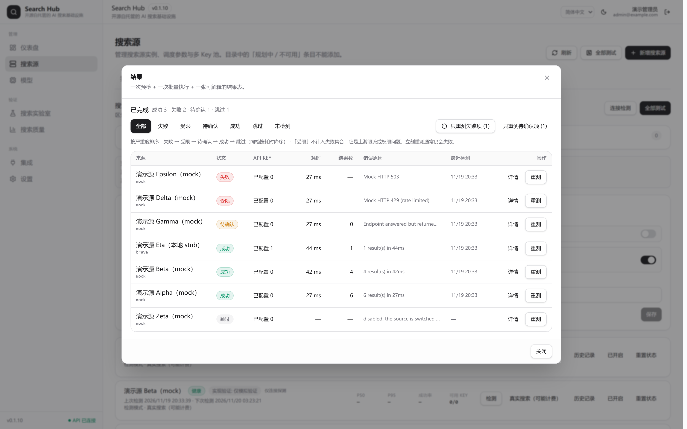
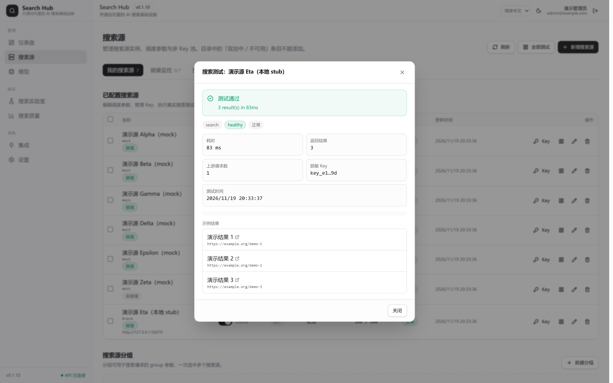

# Search Hub

**Self-hosted AI search infrastructure.** One service that aggregates multiple search providers, manages pools of API keys, normalizes and fuses results, and exposes the same engine over REST, MCP, and Agent Skills.

[中文](./README.md) · [Architecture](./docs/architecture.md) · [Deployment](./docs/deployment.md) · [API](./docs/api.md) · [MCP](./docs/mcp.md) · [Skills](./docs/skills.md) · [Legacy migration](./docs/legacy-migration.md) · [Testing](./docs/testing.md) · [AC matrix](./docs/ac-matrix.md) · [Acceptance report](./docs/acceptance-report.md) · [Release readiness](./docs/release-readiness.md) · [Live validation plan](./docs/real-search-validation-plan.md) · [Capability inventory](./docs/capability-inventory.md) · [Remote acceptance](./docs/github-remote-acceptance-plan.md) · [Provider guide](./docs/provider-plugin-guide.md)

> **Status: v0.1.10 · Stable Release (the maintainer's public release channel).**
>
> Core search, key scheduling, the admin UI (Chinese and English), REST, MCP (both protocol eras), Skills, the persistent result cache, the provider health centre and the search quality lab are implemented and covered by **1034 automated tests across 78 files**. **The Docker image and the 11-item container acceptance have passed on GitHub Actions (ubuntu-latest)** — 24/24, including compose start, initialisation, a real search, persistence, crash recovery, MCP and Trivy (0 HIGH / 0 CRITICAL).
>
> **Stable means "this is the public release channel the maintainer ships", not "every third-party integration is production-certified".** Concretely: **Hacker News, Crossref, OpenAlex and PubMed are verified against the real network**; Tavily, Bocha, Brave, SearXNG and the rest are implemented from their official docs and are **not yet verified against real search results**; the quality lab currently has synthetic fixtures only, with **no vendor-labelled qrel set**. Those gaps are listed per provider in the [provider matrix](./docs/provider-matrix.md), the [release readiness report](./docs/release-readiness.md) and the [CHANGELOG](./CHANGELOG.md). Nothing untested is described as verified.

---

## Why

A single search API gives you one quota, one point of failure, and one ranking. A home-grown aggregator then has to solve key rotation, rate limits, de-duplication, fusion, and agent protocols again.

Search Hub packages that as a deployable service:

- **Multi-provider fan-out** — one query hits several providers concurrently; a failing provider never fails the whole search, and partial results carry explicit failure reasons.
- **Key pools** — any number of keys per provider, with round-robin, random, weighted-random, least-used, and failover strategies. Per-key concurrency, RPM, daily quota, cooldown, and circuit breaking.
- **One result shape** — URL canonicalization, exact and near-duplicate merging, RRF fusion, and full source attribution with original ranks.
- **Three entry points, one engine** — REST, MCP, and Skills all call the same `executeSearch`.
- **Optional intelligence** — cited AI summaries, embedding-based semantic re-scoring, and reranking. All optional; basic search works with no model configured.

## Capabilities

| Capability | Status | Notes |
|---|---|---|
| Concurrent multi-source search + partial success | Implemented | Per-source timeout, global deadline, isolation, client cancellation |
| Key pool scheduling (5 strategies) | Implemented | Atomic slot reservation with a bounded wait queue; 100 concurrent requests cannot exceed the per-key concurrency / RPM / daily quota |
| 429 / 401 / 5xx handling | Implemented | 429 honours `Retry-After`; 401/403 suspends the key; 5xx backs off and trips a breaker |
| URL canonicalization + dedupe + RRF | Implemented | All sources retained; RRF `k` configurable (default 60) |
| Admin UI (light/dark, Chinese + English) | Implemented | Dashboard, sources, keys, models, search lab, integrations, settings, logs; header language switcher, choice persisted |
| REST + OpenAPI 3.1 | Implemented | `/api/openapi.json`, `/api/docs` |
| MCP server | Implemented | 2026-07-28 modern envelope + 2025-11-25 handshake; Streamable HTTP and stdio |
| Agent Skills | Implemented | Three `SKILL.md` packages |
| AI summary / embedding / rerank | Implemented, optional | OpenAI-compatible, Anthropic, Gemini, Cohere/Jina-compatible, custom HTTP |
| Result cache (SQLite, persistent) | Implemented | 1–72 h TTL; survives restart and container rebuild; LRU eviction at a byte cap; expired rows swept every 10 minutes |
| Search quality lab | Implemented | Four-grade human relevance judgments + P@10 / Recall@10 / MRR@10 / nDCG@10; offline baseline with no network and reproducible numbers; single / base / RRF comparison; RRF sweep with a development/holdout split; incomplete qrels produce N/A and INSUFFICIENT_EVIDENCE |
| Provider health centre | Implemented | Implementation verification kept separate from runtime state; connectivity probe (one minimal request) and paid search probe; durable, concurrency-safe budget; exponential backoff and automatic recovery; per-source switch and reset |
| PostgreSQL | Not implemented | SQLite only; the data layer is isolated |
| Redis multi-instance coordination | Not implemented | Single-process quota guarantees only |

### Provider health centre

"Configured" and "working" are different claims. This page keeps them apart:

| Axis | Values |
|---|---|
| Implementation verification | `documented` / `mock_verified` / `live_tested` / `unverified` — how the adapter was validated. **A passing probe never upgrades it.** |
| Runtime state | `healthy` / `degraded` / `rate_limited` / `quota_exceeded` / `invalid_credentials` / `permission_denied` / `cooldown` / `unknown` / `unverified` / `disabled` — whether this instance works right now |

- **Two probe kinds.** A connectivity probe sends one minimal request and only proves that DNS, TLS and the credential can establish a session — for a source that needs a credential the request still carries it, so it is not advertised as free. A search probe calls the vendor's search endpoint; only that can claim "it can search right now". Completely keyless sources (HN / Crossref / OpenAlex / PubMed / arXiv / Wikipedia) can be verified with a real search without the paid switch, and are counted in their own bucket.
- **Budget.** At most 3 search probes per run and 20 per day by default (adjustable, with hard caps). Counters live in the database, survive a restart, and cannot be exceeded by concurrent probes; if the reservation cannot be written, no request is made.
- **Automatic recovery.** Transient failures retry sooner with exponential backoff; terminal failures wait for the normal interval. One failure never permanently disables a source, and a success returns it to `healthy`.
- **Off by default.** Scheduled probing only runs once you enable it, within the interval and the budget.
- **A source with no API key never reports healthy** — it reports `unverified`.

#### Bulk test in one pass

A single source can be probed; every source can be tested in one run. 「全部测试」 sits in the **source page header** and in the health tab, and both open the same pre-flight flow. The flow has three steps, and each one is readable before you commit:

| Step | What you see |
|---|---|
| **Preview** | Six counts (testable / no key / config error / disabled / keyless skipped / cooling & budget) + today's remaining budget + whether third-party quota is at stake. The seven figures add up to the scope total, so no source disappears silently |
| **Run** | Live progress (`done/to test`, percentage, current source), four counters (ok / failed / pending / skipped), and a cancel button |
| **Results** | An eight-column table: source (name + adapter type) / state / API key (configured **count**) / latency / result count / error reason / last checked / actions (details, retest this row). Sorted by severity (failed → restricted → pending → ok → skipped), filterable, with "retry failures only". The detail drawer carries the classification, advice, measured upstream requests and up to three samples |

- **Only sources with a configured key are tested by default.** Sources without a credential are skipped as "no key", never counted as failures, and never enter the success-rate denominator.
- **Keyless sources are skipped by default.** The preview can include them for this run; they are real searches and do make a third-party request.
- **Skipped is not failed.** A skipped source gets no health conclusion and never appears in "retry failures".
- **Cost is stated before it is incurred.** When a search run may spend vendor quota, the preview shows the estimated probe count; when paid probing is off, the start button is disabled with the reason — you never have to click to find out.
- **Cancel is readable afterwards.** Finished conclusions stay readable; the untested remainder is marked "cancelled".
- **A restart does not lie.** If the process dies mid-run, the job is `interrupted` (partially complete) and never reported as "all done".
- **A reload can come back to it.** Starting a run leaves a job pointer in the browser; after a reload a notice above the tabs says "a previous test is still running (x of y done)" or "the last test finished (partially complete)", and one click reopens the run at the right step. A job that no longer exists, or belongs to another account, is cleared silently.
- **Unmeasured fields are `—`.** A probe that sent nothing has no latency, result count or request count; `0` is never used to stand in for a measurement, and no screen ever shows a plaintext API key.

[](docs/screenshots/v0110/provider-batch-test.png)

[](docs/screenshots/v0110/provider-test.png)

Details: [docs/provider-health.md](./docs/provider-health.md).

## Search quality evaluation

"Which source is better" is now answered with a fixed dataset, human judgments and reproducible metrics instead of intuition.

- **Four grades**: 0 off-topic / 1 mentions it / 2 answers part / 3 answers the intent. Binary metrics treat >= 2 as relevant. Machine-assisted grades are stored as `machine_generated` and never become ground truth.
- **Unjudged is not non-relevant.** Unjudged documents are removed from the metric window and the query is marked provisional; a query with no judgments returns **N/A**, never 0. Recall is explicitly N/A when the qrels are incomplete.
- **Two modes**: `offline` reads a stored snapshot or the built-in fixture — **no network, no quota spent**; `live` uses the same path as a user search (same key pool, scheduler, SSRF guard and health gate) and requires an explicit provider list, a request ceiling and a cost acknowledgement. The worst case (queries x providers x 2 attempts) is checked **before** the first request is issued.
- **Fair comparison**: `snapshotRunId` re-ranks the *same* raw rows. Two runs of different dataset versions are refused outright.
- **Offline RRF tuning**: only k = 20/40/60/80/100 and fixed provider weights, chosen on the development split and reported on the holdout; without enough evidence it says **INSUFFICIENT_EVIDENCE**. Production stays at k=60 — this release does not change ranking.
- **CI gate**: `pnpm quality:eval` runs 11 hand-computed self-checks and then compares nDCG@10 against the committed baseline, failing on a regression. Synthetic fixture numbers validate the machinery; they are **not** a measurement of any vendor.

Details: [docs/search-quality.md](./docs/search-quality.md).

## Supported providers

**Implemented adapters (50 kinds)**

The table below lists the representative ones; the full, generated list is [`docs/provider-matrix.md`](./docs/provider-matrix.md), which CI keeps in sync with `packages/providers/src/catalog.ts`.

| Type | Auth | Notes | Verification |
|---|---|---|---|
| `hackernews` | None | HN Search official hosted API (Algolia) | **live_tested** — evidence in `docs/live-evidence/hackernews.json` |
| `crossref` / `openalex` / `pubmed` | None | Public scholarly APIs | **live_tested** — recorded calls in `docs/live-evidence/` |
| `tavily` / `bocha` / `brave` / `searxng` | API key / optional | Written from official docs, covered by local contract tests | `documented` — **never called with a real key** |
| `minimax` | Bearer | Coding Plan `web_search`, protocol taken from the official MCP source | `documented` — no Coding Plan credential here |
| `metaso` / `metaso-mcp` | Bearer / none | Metaso `/api/v1/search`; plus an MCP compatibility entry | `documented` — endpoint and error envelope confirmed by a real unauthenticated probe |
| `duckduckgo` | None | Instant Answer API only — it is not a general web search, and the adapter says so in `warnings` | `documented` — the adapter states this in `warnings` |
| `gemini` / `grok` / `mimo` / `bailian` | API key | Grounded-answer adapters (`capability: grounded_answer`) | `documented` |
| `doubao` / `deepseek-search` / `qianfan-search` / `tencent-yuanbao` / `stepfun` | API key / key pair | Native search adapters | `documented` |
| `generic-http` | Configurable | Declarative request + response mapping | Tested against a local mock server |
| `search-hub-legacy` | Optional | Calls an existing Search Hub REST `/api/search`; read-only, reversible | Contract-tested against a local fake |
| `mock` | None | Deterministic test source | `mock_verified` — never counted as vendor coverage |

**Catalogue entries that cannot be created**: only `baidu`. It has no publicly available general web-search API, and scraping its HTML violates its terms, so the entry is kept as documentation. The seven `generic` presets (Search Gateway, Premium, ORZ Fetch and friends) **are** creatable — they need you to supply the endpoint and result paths.

> 58 catalogue entries: 50 native adapters, 1 with no official API, 7 generic presets. A fresh install contains no sources; add them from the marketplace. The project **does not claim support for 58 search engines** — "in the catalogue" is not "verified working". See [docs/provider-matrix.md](./docs/provider-matrix.md) per provider.

Three states are kept strictly apart: **implemented** (`builtin`, an adapter written against the vendor protocol), **contract-tested** (`mock_verified`, proves the code path against a local double and never touches the vendor), and **live-tested** (`live_tested`, backed by a recorded real call). Only Hacker News, Crossref, OpenAlex and PubMed are live-tested; every other adapter is implemented but unverified against the real service.

## Download (v0.1.10)

Three shapes, one search core, one database model, one admin UI.

| Platform | Download | Requirements |
|---|---|---|
| Windows x64 | [`search-hub-v0.1.10-windows-x64.zip`](https://github.com/alicia1030su/search-hub/releases/download/v0.1.10/search-hub-v0.1.10-windows-x64.zip) | **None** (no Node / pnpm / Git / Docker) |
| Linux x64 | [`search-hub-v0.1.10-linux-x64.tar.gz`](https://github.com/alicia1030su/search-hub/releases/download/v0.1.10/search-hub-v0.1.10-linux-x64.tar.gz) | **None** (Node runtime bundled) |
| Linux arm64 | [`search-hub-v0.1.10-linux-arm64.tar.gz`](https://github.com/alicia1030su/search-hub/releases/download/v0.1.10/search-hub-v0.1.10-linux-arm64.tar.gz) | **None** |

Verify: download [`SHA256SUMS`](https://github.com/alicia1030su/search-hub/releases/download/v0.1.10/SHA256SUMS) and run `sha256sum -c SHA256SUMS`. Each release asset also carries **build provenance**; check it with `gh attestation verify <asset> --repo alicia1030su/search-hub`. The two checks answer different questions: SHA256 proves the bytes, provenance proves which workflow and commit produced them.

> **v0.1.10 adds a one-click provider check-up.** Every source keeps its own test
> button, and the page gains a **Test all** action. Before anything is sent you see
> the pre-flight split — testable / no key / keys all disabled / config error /
> disabled / keyless skipped / cooling down — whose seven counters always sum to
> the scope total. By default only sources with a **usable configured key** are
> tested; a source that requires a key and has none sends **no request at all**.
> Keyless public sources are skipped unless you explicitly opt in. While running,
> progress and the current source are shown and the run can be cancelled; the
> result table orders failed → restricted → pending → ok → skipped and gives the
> real error class, latency, result count and the **measured** upstream request
> count (never estimated from the planned page count). Skips never count against
> the success rate. A run interrupted by a restart is marked `interrupted` at the
> next boot and can never masquerade as `completed`. The single-source button now
> runs the **same** production probe as the scheduler — previously it built its own
> config, omitted the resolved search config and sent a single request. Migration
> `0008`.
>
> **v0.1.10 makes an evaluation score attributable.** Every run records the
> sources that actually took part, a credential-free fingerprint of their ranking
> settings, the qrel-set fingerprint and the model fingerprint — rotating an API key
> does not move any of them, because a key rotation is not a configuration change.
> Runs recorded before this version report `provenanceComplete: false` instead of
> being back-filled from today's settings. Queries may carry several category labels,
> reports break down per category and state that the groups overlap, and the
> comparison report now shows document-level rank movements (a document present on
> one side only has `deltaPositions: null`, never 0). A failed write marks the run
> failed with a reason and a full disk returns 507, instead of leaving the run at
> `running` forever. Adds migration `0007` (columns only); the default RRF ranking
> is unchanged.
>
> **v0.1.9 fixes request budgeting and request isolation.** The evaluation budget now
> counts **real HTTP requests** — pages, retries and redirect hops included, and an
> SSRF-refused hop is not charged — concurrent searches no longer share the health-gate
> skip list, Deep Search reports parked sources instead of dropping them, and a failed
> query can no longer be recorded as a success just because an empty snapshot exists.
> No database migration; production ranking is unchanged.
>
> **v0.1.8 adds the search quality evaluation lab**: four-grade human relevance
> judgments, P@10 / Recall@10 / MRR@10 / nDCG@10, single-provider vs base vs RRF comparison,
> an RRF sweep with a development/holdout split, and `pnpm quality:eval` as an offline CI
> gate. Unjudged documents never count as non-relevant, recall is N/A when the qrels are
> incomplete, and a comparison without enough evidence says INSUFFICIENT_EVIDENCE. The
> production RRF behaviour is unchanged.
>
> **v0.1.7-beta.3 fixes a defect only visible when accepting the published package.** Fastify
> rejects an empty JSON body, malformed JSON, an unsupported content type and an oversized body
> before any route runs; those errors carry a 4xx `statusCode`, but the global handler folded
> everything that was not a `SearchHubError`, a `ZodError` or a 429 into `500 internal_error`. A
> caller who sent a broken request was told the server had broken, and the error log filled with
> ordinary bad traffic. These now return **400 / 415 / 413** with a stable `bad_request` code and
> are logged at debug level; a real internal failure still returns 500. See
> [CHANGELOG](./CHANGELOG.md).
>
> **v0.1.7-beta.2 closed out the health centre and the bilingual UI.** Keyless public sources
> (Hacker News / Crossref / OpenAlex / PubMed / arXiv / Wikipedia) are no longer judged as
> "no usable key", and can be verified with a real search without the paid switch. Probes now
> use the resolved search plan, so paginated adapters no longer issue zero requests and get
> recorded as `empty_results`. A cancelled probe no longer refunds its budget slot. Certificate
> errors are classified as `tls` instead of `network`. The UI ships a complete en-US locale
> (923 keys, type-enforced complete, persisted across reload, dates and numbers follow the
> language). Eight failure modes — DNS, TLS, handshake, timeout, connection refused, HTML
> masquerading as JSON, mid-flight cancel, redirect into a private address — are covered
> through the real request path. See [CHANGELOG](./CHANGELOG.md).
>
> **v0.1.7-beta.1 rebuilt provider health management**: implementation verification (was it ever
> really called?) and runtime state (can it be used now?) are fully separated; connectivity
> probing (one minimal request) and real search probing are distinct, and the latter is off by
> default and bounded by a durable budget (3 per run / 20 per day, not reset by a restart,
> not exceedable by concurrency); transient failures retry sooner with exponential backoff and
> recover automatically — one failure never permanently disables a source.
>
> **v0.1.6-beta.1** added the catalogue entries for the MiniMax and Metaso sources that beta.1
> omitted, plus a `get_provider_health` MCP tool, dashboard health cards, health-aware
> scheduling and a self-updater with automatic rollback.
>
> **v0.1.5-beta.1** introduced provider health monitoring: 401/403/429/quota classified
> separately, keyless sources shown as `unverified` rather than healthy, and MCP protocol
> versions reported from **measurement** — the current SDK does not support `2026-07-28`, and
> the UI says so. See [MCP protocol measurement](./docs/mcp-protocol.md).
>
> **v0.1.4-beta.5 and earlier are superseded by a security update; please upgrade.** beta.5 has
> a confirmed access-control defect: any API token could read and cancel another token's search
> tasks (see the [beta.6 audit](./docs/beta6-audit.md)). beta.6 fixes it, along with five other
> issues including fake Deep Search success, an incomplete cache key and disabled models still
> being callable. Older downloads and tags are left untouched.

**Windows**: unzip → double-click `SearchHub.exe` → the browser opens `http://127.0.0.1:8787`. The first-run setup token is written to `%LOCALAPPDATA%\SearchHub\setup-token`. `--service` runs it headless (a closed Windows Server session does not stop it); `--status / --stop / --logs / --autostart` are documented in the bundled README.txt.

**Linux**:

```bash
mkdir search-hub && tar -xzf search-hub-v0.1.10-linux-x64.tar.gz -C search-hub
cd search-hub && ./bin/search-hub          # 127.0.0.1:8787, headless, no browser
```

For long-running use, the package ships `search-hub.service` (non-root, `ProtectSystem=strict`, data in `/var/lib/search-hub`).

**Docker**:

```bash
docker pull ghcr.io/alicia1030su/search-hub:0.1.10    # or omit the tag to get latest
# The image is built for linux/amd64 only; use the arm64 package above on arm64 hosts
docker compose up -d                                        # or build from source
```

Differences between the standalone packages and the three shapes: [docs/standalone-packages.md](./docs/standalone-packages.md).

> Release artefacts are unpacked and started on real Windows and Linux (x64 / arm64) and run through the same acceptance: health check → first-run initialisation → REST search → MCP initialize/tools.list/tools.call → database and master key on disk → stop → restart with data intact. Before publishing, every asset is downloaded again and its SHA256 checked.

## Quick start

### Docker Compose (recommended)

```bash
git clone https://github.com/alicia1030su/search-hub.git
cd search-hub
cp .env.example .env
# Strongly recommended: set a stable master key
# openssl rand -hex 32  →  SEARCH_HUB_ENCRYPTION_KEY
docker compose up -d
```

Open `http://localhost:8787`. The first visit creates the administrator account — there is no default password.

**First-run initialisation requires a one-time setup token.** When `SEARCH_HUB_SETUP_TOKEN` is unset the server generates `data/setup-token` (mode 0600) and logs only the file path, never the value. Read it with `docker compose exec search-hub cat /app/data/setup-token`, then paste it into the setup form. Without it nobody can claim the administrator account. Then:

1. **Sources → Add source**. Zero credentials: pick **Hacker News** (official Algolia API, live results) to validate the whole chain. With a key, pick **Tavily / Bocha / Brave**; with a self-hosted instance, pick SearXNG. All four non-HN adapters are `documented` (no live verification); see [the provider matrix](./docs/provider-matrix.md).
2. **Test** performs a real request and shows the exact error code on failure.
3. **Search lab**: run a query, inspect per-source latency, failures, dedupe counts, and fused ranks.
4. **Integrations**: create an access token and copy the MCP configuration.

### Local development

```bash
corepack pnpm install
corepack pnpm build      # web bundle + server bundle (dist/server.mjs)
corepack pnpm dev        # API :8787 + Vite :5173
corepack pnpm test       # unit + integration
corepack pnpm start      # run the compiled artefact (production shape)
```

Requires Node ≥ 22.12 (`better-sqlite3` 13, Vite 8) and pnpm 12.

## Keys and scheduling

Each provider can have multiple independent instances (`brave-eu`, `brave-us`) with their own URL, key pool, concurrency, priority, and strategy.

- **Encryption**: AES-256-GCM; the master key comes from `SEARCH_HUB_ENCRYPTION_KEY` or a generated `data/master.key`. The API only returns a first-4 + last-4 mask (for example `sk-1…abcd`).
- **Strategies**: `round_robin`, `random`, `weighted_random`, `least_used`, `failover`.
- **Quota**: per-key concurrency + requests per minute + optional daily quota; exceeding it returns an explicit error rather than dropping requests.
- **Health**: `healthy`, `rate_limited`, `cooldown`, `invalid`, `disabled`, `unknown`; each key can be tested or reset individually.

## MCP

**Remote (Streamable HTTP)**

```json
{
  "mcpServers": {
    "search-hub": {
      "type": "http",
      "url": "https://search.example.com/mcp",
      "headers": { "Authorization": "Bearer sh_your_token" }
    }
  }
}
```

> `search.example.com` and `sh_your_token` are placeholders; replace them with your hostname and a real token.

The token needs `mcp:use` and `search`; `get_search_sources` also needs `sources:read` (all three are preselected in the UI). It is shown once when created.

**Local (stdio proxy to the same REST API)**

```json
{
  "mcpServers": {
    "search-hub": {
      "command": "node",
      "args": ["/path/to/search-hub/packages/mcp/dist/stdio.mjs"],
      "env": {
        "SEARCH_HUB_URL": "http://127.0.0.1:8787",
        "SEARCH_HUB_TOKEN": "sh_your_token"
      }
    }
  }
}
```

Tools: `search_web`, `search_multi`, `search_deep`, `search_news`, `search_with_sources`, `search_and_rerank`, `search_and_summarize`, `get_search_sources`, `get_search_status`.

The stdio server proxies REST; stopping the API makes stdio calls fail, proving there is no second search implementation. See [docs/mcp.md](./docs/mcp.md).

## Skills

Three standard `SKILL.md` packages live in `packages/skills/`:

- `search-web` — single search with citation rules
- `deep-research` — multi-query research with synthesis
- `research-with-citations` — an auditable evidence table

Copy them into your agent's skills directory, or download them from **Integrations → Skills**. A skill only needs `SEARCH_HUB_URL` and `SEARCH_HUB_TOKEN`; provider keys never leave the server.

## Custom providers

No code required: **Sources → Add → Generic HTTP/JSON**:

- method, path, headers, query, JSON body (`{{query}}`, `{{key}}`, `{{limit}}`, `{{language}}`, `{{freshness}}`, `{{page}}`)
- key injection (header / query / body, optional prefix)
- results array path (`data.items`) and field mapping (title / url / snippet / publishedAt / score / language)

Mapping is declarative and restricted to safe dotted paths; no user code is executed. See [docs/providers.md](./docs/providers.md).

## Security defaults

- First-run setup requires a real administrator password and a one-time setup token (generated into `data/setup-token`, or supplied via `SEARCH_HUB_SETUP_TOKEN`), so an exposed port cannot be claimed by someone else.
- Every non-health request validates the Host header — IP literals, `localhost`, the `SEARCH_HUB_PUBLIC_URL` host, and `SEARCH_HUB_ALLOWED_HOSTS` — which blocks DNS rebinding.
- Admin API uses an HttpOnly session cookie with a CSRF header on every mutation; external integrations use revocable, scoped, rate-limited bearer tokens.
- Every outbound request passes SSRF protection: DNS classification, connect-time `lookup` filtering, manual per-hop redirect re-validation; loopback, private, link-local, CGNAT and cloud-metadata addresses are refused by default. IPv4-mapped IPv6 (`[::ffff:127.0.0.1]`) is covered too.
- **Proxied egress has an explicit trust boundary**: only `SEARCH_HUB_OUTBOUND_PROXY` enables a proxy (environment variables such as `HTTPS_PROXY` are never read implicitly), and `SEARCH_HUB_OUTBOUND_PROXY_TRUST` defaults to `untrusted`, in which case private targets are refused even when allowlisted. The app still validates every hop, but the target resolves at the proxy; the residual DNS-rebinding risk is covered by the `trusted-networks` declaration plus the proxy egress policy. See [SECURITY.md](./SECURITY.md).
- Logs redact `authorization`, `cookie`, `apiKey`, `password`, and `token`; keys never appear in API responses, exports, or logs.
- Retrieved content is always passed to models as untrusted data, with an explicit boundary and injection pattern detection.
- Production responses carry CSP, `X-Frame-Options: DENY`, `nosniff`, and related headers.

See [SECURITY.md](./SECURITY.md). Report vulnerabilities privately.

## Verification

**Automated (reproducible in this repo)**

- **1034 unit/integration tests across 78 files**, covering the three quota tiers (concurrency/RPM/daily) and their peaks, a 429/401/5xx/timeout/malformed matrix (50 runs each), dedupe, hand-computed RRF, SSRF (direct, proxied, and IPv4-mapped IPv6), a three-way secret leak scan, provider contracts, model chain security, MCP over both transports with the official client, 100 concurrent searches, online-backup consistency under writes, and restart persistence.
- **Persistent cache — 23 cases** (`tests/integration/cache.test.ts`) **plus 3 migration cases** (`tests/unit/cache-migration.test.ts`): hits, isolation, TTL expiry, automatic sweep, survival across restart, concurrency, capacity eviction, response validation, credential isolation. TTL is checked with an injected clock, not by sleeping.
- **Provider health centre — 35 cases** (`tests/integration/provider-health-center.test.ts`): off by default, no-key ⇒ `unverified`, both probe kinds, cause classification, budget concurrency/restart/overrun, backoff and recovery, one dead key, in-flight de-duplication, shutdown cleanup, no key leakage, permissions, reset, the cache never faking health, cancel not refunding, multiple keys on one shared account quota, and MCP/REST sharing the same gate. Injected clocks and controlled scheduling; no real waiting. The "paid" source in these tests is a local Brave contract server with a real key — no vendor is ever called.
- **Credential classes — 6 cases** (`tests/integration/credential-classes.test.ts`): the catalogue and adapters agree on which sources take a key; a key-required source with no key is `unverified`; a keyless source probed against a local HN-wire-format stub can report `healthy`; `/api/health` stops counting keyless sources as unusable; a source needing its own instance URL is a configuration problem.
- **Real network failures — 8 cases** (`tests/integration/network-failures.test.ts`): DNS resolution failure, a self-signed certificate, TLS against a plaintext port, a closed port, a server that never answers until the deadline, HTML where JSON is expected, an abort mid-flight, and a redirect into a private address. Every case goes through the real safe-fetch path — no mock objects carrying error strings.
- **i18n parity — 5 cases** (`tests/unit/i18n-parity.test.ts`): full key coverage, no CJK in English values, identical placeholders, no empty values, no hardcoded zh-CN formatter.
- A 16-row acceptance matrix (PASS 11 / PARTIAL 4 / BLOCKED 1) generated from `docs/ac-matrix.json`: [docs/ac-matrix.md](./docs/ac-matrix.md).
- Scripts: `smoke.sh` (setup → two sources → test → key → multi-source search → failure isolation → token → MCP initialize), `live-search.mjs` (real HN search, REST/MCP parity), `mcp-live.mjs` (official client, both transports), `leak-scan.mjs` (response/DB/log triple scan), `clean-install.mjs` (production install into a clean directory).
- Playwright **38 cases**: first-run (including the setup token), login, add source, search lab, theme, settings, integrations, the "not implemented" catalogue marker, a language switch that leaves no Chinese in `<main>` and survives a reload, and the v0.1.10 provider health work (single-source pass/failure, a measured upstream request count, bulk preview and progress, cancel, retry-failures-only, the eight-column table, reload recovery, double-click idempotence, a mixed five-kind scope, and the keyless policy).

**Not verified (requires credentials or infrastructure)**

- Brave: no subscription key; no live call to `api.search.brave.com`.
- SearXNG: no self-hosted instance.
- Docker: **locally** the Docker engine is unavailable (WSL is blocked by policy); **remotely** GitHub Actions builds the image and runs the 11-item container acceptance (24/24, see the Docker workflow under Actions). The two are not interchangeable.
- AI / embedding / rerank: no vendor keys; request/response contracts tested against local mock servers only.
- Multi-instance: Redis coordination is not implemented; quotas are guaranteed per process.

These limits are repeated in [docs/testing.md](./docs/testing.md) and the release notes.

## Known limitations

- **SQLite only** — PostgreSQL is not implemented. Data access is isolated in `packages/db` and the service layer.
- **Single-instance quota** — key concurrency and RPM state live in memory. A crash can lose the current 60-second window and in-flight counts; startup recalibrates approximately from the day's events. `kill -9` is not covered by the hard quota guarantee.
- **No persistent vector index** — embeddings re-score results within one request.
- **No multi-tenancy** — one administrator, no team permissions.
- **In-process rate limiting** — multiple replicas would each enforce their own limits.
- **Health probing is per instance** — the budget ledger is a SQLite table, so two replicas keep two ledgers.

## Layout

```
apps/api          Fastify: REST, admin API, MCP mount, static web
apps/web          React + Vite + Tailwind admin UI
packages/shared   Types, Zod contracts, URL canonicalization, SSRF-safe fetch
packages/db       Drizzle schema, SQL migrations, SQLite client
packages/core     KeyScheduler, fan-out, dedupe, RRF, error classification
packages/providers Provider registry, catalog, Tavily/Bocha/Brave/SearXNG/Generic/Mock
packages/models   Chat / embedding / rerank adapters, summary, injection guard
packages/mcp      MCP v2 server (HTTP + stdio)
packages/skills   Three SKILL.md packages
docs              Architecture, API, MCP, Skills, providers, deployment, testing
tests             unit / integration / e2e / scripts
```

## Testing

```bash
pnpm test                    # Vitest: unit + integration (1034 cases)
pnpm build && pnpm test:e2e  # Playwright (18 cases)
bash tests/scripts/smoke.sh http://127.0.0.1:8787
node tests/scripts/leak-scan.mjs        # secret leak scan, starts its own instance
node tests/scripts/mcp-live.mjs --url http://127.0.0.1:8787 --token sh_xxx
```

Layers, coverage, and gaps: [docs/testing.md](./docs/testing.md).

## Contributing

See [CONTRIBUTING.md](./CONTRIBUTING.md). A new provider must ship with: an official documentation link, error mapping, mock tests, and an honest live-verification status.

## License

[MIT](./LICENSE)
