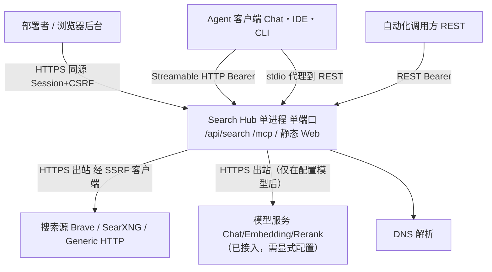
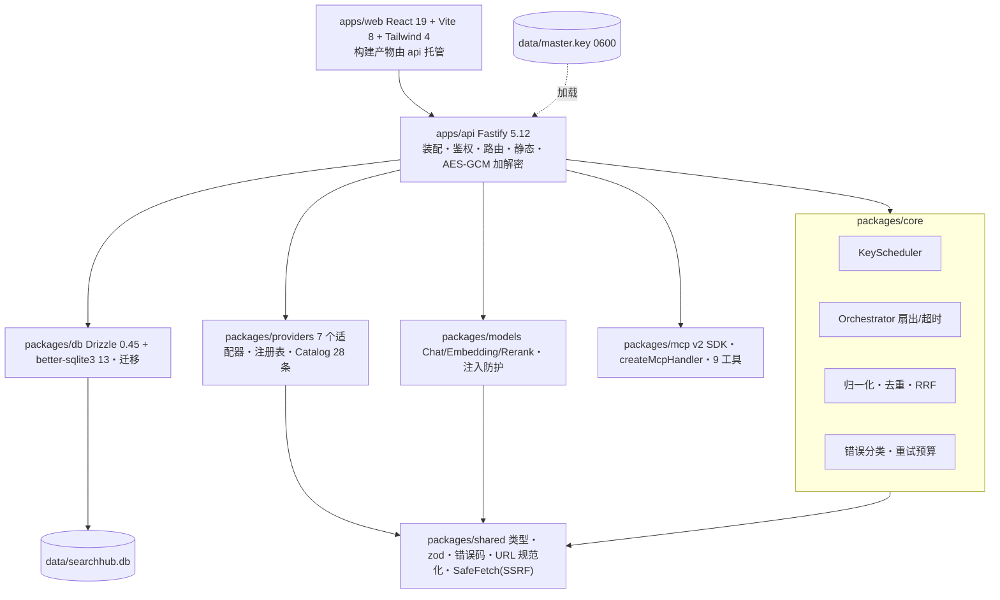
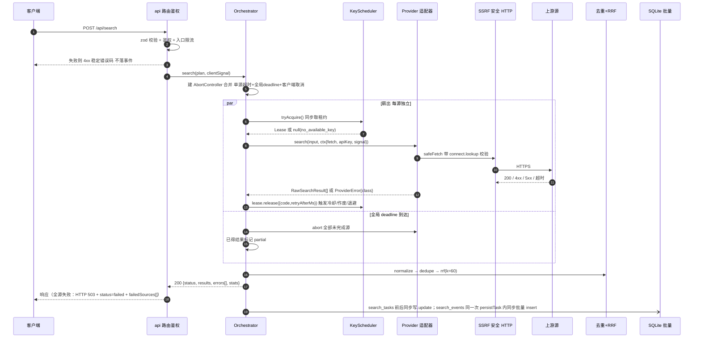
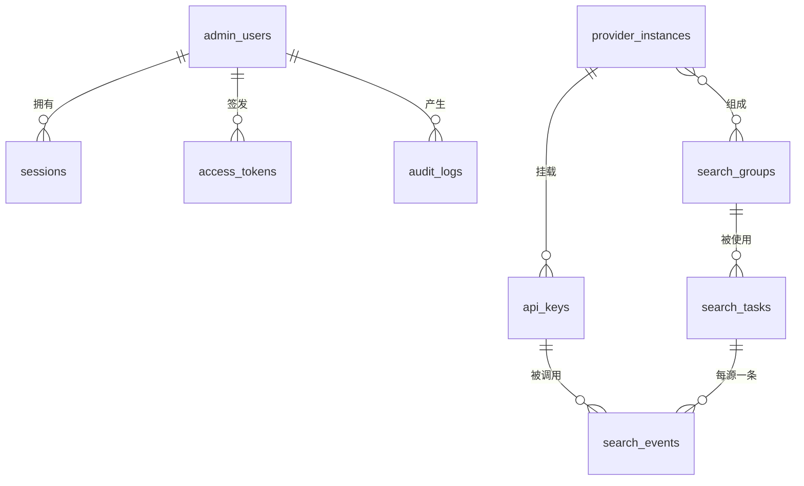

# Search Hub 架构设计（v0.1.1 事实基线）

> 本文在 v0.1.1 按**仓库实际代码**重写了对账表。历史版本中的 E-1…E-6 / D-1…D-6 待裁决项均已落地或有结论，不再作为"偏离"保留。
> 标注约定：`【已实现】`＝仓库内可运行且被测试覆盖；`【未实现】`＝不在本期，不得对外声称支持；`【待联调】`＝代码就绪但缺真实凭证/实例。
> 版本已与 `pnpm-lock.yaml` 核对：fastify 5.12.8、better-sqlite3 13.1.1、drizzle-orm 0.45.4、vite 8.3.8、react 19.3.1、tailwind 4.3.5、zod 4.6.7、undici 8.12.4、typescript 5.9.3、@modelcontextprotocol/server 2.4.0、node ≥22.12。

| # | 事实 | 当前实现 | 验证方式 |
|---|---|---|---|
| F-1 | MCP 依赖与协议 | `@modelcontextprotocol/server@2.4.0`（v2 线），现代 2026-07-28 envelope + 2025-11-25 传统握手；`createMcpHandler().fetch(Request)` | `tests/integration/mcp.test.ts`、`mcp-client.test.ts` |
| F-2 | REST 路径与失败字段 | `POST /api/search`；失败源字段 **`failedSources[{id,code}]`**，另保留 `errors[{providerId,providerName,code,message}]` | OpenAPI + 集成测试 |
| F-3 | 全源失败 | **HTTP 503** + `status:"failed"` + `failedSources[]`，不用 200 空结果冒充成功 | `search-errors.test.ts` |
| F-4 | 100 并发与排队 | 原子占额 + **有界等待队列**（最多 1024 个等待者，单次等待预算默认 2s）；等待者由 `release()` 唤醒，不轮询；排队超时返回 `queue_timeout` | `key-limits.test.ts`、`concurrency.test.ts` |
| F-5 | 模型能力 | Chat / Embedding / Rerank 为**真实适配器、默认关闭**；可选阶段失败时响应 `stats.degraded=true`，基础结果照常返回 | `model-degradation.test.ts` |
| F-6 | 能力目录 | `catalog.ts` **28** 条元数据 = 7 个已实现适配器（Tavily / Bocha / Brave / SearXNG / Hacker News / Generic HTTP / Mock）+ 12 planned + 2 unavailable + 7 generic 入口 | `node --import tsx` 统计 + `providers.test.ts` |
| F-7 | 超时默认值 | 全局 15s、单源 12s、`maxRetries=1`；全局 deadline 优先 | `settings.ts` / 集成测试 |
| F-8 | 首次初始化 | 未初始化时自动生成一次性 setup token（`data/setup-token`，0600；或 `SEARCH_HUB_SETUP_TOKEN`），`POST /api/setup` 必须携带；事务内二次校验，防抢占与并发双管理员 | `security-hardening.test.ts` |
| F-9 | Host / 代理边界 | 所有非健康检查路由校验 Host（IP 字面量、localhost、`SEARCH_HUB_ALLOWED_HOSTS`/`PUBLIC_URL`）；`SEARCH_HUB_TRUST_PROXY=true` 只信任回环代理，跨网段需显式 CIDR | `security-hardening.test.ts`、`mcp-client.test.ts` |
| F-10 | 生产运行形态 | `scripts/build-server.mjs` 用 esbuild 产出 `apps/api/dist/server.mjs` 与 `packages/mcp/dist/stdio.mjs`；运行时不再依赖 tsx/TypeScript | 干净目录 `pnpm install --prod` 后启动验证 |

## 1. 架构总览

### 1.1 系统上下文



边界原则：被动服务，不主动发起搜索、不抓取、不自主决策；外部依赖默认不可靠，单个依赖失效不得导致进程崩溃或"空结果冒充成功"。

### 1.2 容器与模块



### 1.3 模块职责与依赖方向

| 模块 | 职责 | 允许依赖 | 禁止 |
|---|---|---|---|
| `packages/shared` | 领域类型、zod schema、错误码、URL 规范化纯函数 | 仅 zod | 任何内部包；fs/http/io |
| `packages/db` | Drizzle schema、连接与 PRAGMA、手写迁移执行器、Key 加解密 | shared | core / providers / api |
| `packages/core` | KeyScheduler、编排、去重、RRF、错误分类、重试预算 | shared、providers(接口) | db（走注入端口）、api、直接发 HTTP |
| `packages/providers` | 适配器、注册表、SSRF 安全 HTTP、能力目录 | shared | core / db；读进程 env |
| `packages/models` | Chat/Embedding/Rerank 适配器与智能检索管线（**已实现并接入，默认关闭**） | shared | core / db；被 core 反向依赖 |
| `packages/mcp` | MCP Server、工具定义、双通道 | core、providers、shared | 复制搜索实现；直连 SQLite |
| `apps/api` | HTTP 装配、鉴权、路由、静态、启动初始化、**加解密**（`security/crypto.ts`） | 全部 | 被任何 package 依赖 |
| `apps/web` | 管理后台 SPA | 仅 shared 的纯类型 | 直连 DB；共享运行时代码 |

**实测依赖方向**（`grep` 核对，均为单向、无环）：`apps/api → {shared, core, models, db}`、`packages/core → shared`、`packages/providers → shared`、`packages/mcp → {@modelcontextprotocol/server, shared}`、`packages/models → shared`、`packages/db → shared`。**注意**：`core` 实际**不依赖 providers 包**，只依赖 shared 的类型——比原设计更松，但 `core/engine/fanout.ts` 直接调 `adapter.search()`，因此仍应把适配器接口归到 shared（现状如此），不要再引入反向边。

**禁止循环依赖的具体规则（进 CI，用 dependency-cruiser / eslint-plugin-boundaries）**

1. 依赖只能向下：`apps/* → packages/*`，package 间只允许上表声明的边。
2. `shared` 是叶子：可被任何人依赖，不得依赖任何内部包。
3. `providers` 出现 `import ... from '@search-hub/core'` 即 CI 失败（当前已满足）。
4. `core` 与 `db` **无直接边**（当前已满足）：core 不碰 SQLite，落库由 `apps/api/src/services/*` 负责。
5. `mcp` 与 `api` **无横向边**（当前已满足）：stdio 经 `http-client.ts` 打本机 REST。
6. 跨模块引用一律显式路径（当前 `core`/`providers`/`mcp` 均无 `index.ts` 桶文件反向引用）。
7. `packages/*` 禁止 import `fastify`（唯一例外 `apps/api`）。

### 1.4 核心链路

一次多源搜索（REST 与 MCP 共用同一编排器 `core/engine/search-engine.ts`）：zod 校验 → 鉴权/入口限流 → 解析源组（`providers` 或 `group`）→ 每个源 `tryAcquire()` 取 Key → 并发扇出（单源 `timeoutMs` + 全局 deadline 双重约束）→ 原始结果或分类错误 → 标准化 → URL 规范化 → 精确/近似去重 → RRF(k=60) → **[可选] rerank / embedding 打分 / AI 摘要**（仅当显式请求且模型已配置）→ 组装响应（`status` + `errors[]` + `stats`）→ 同步写 `search_tasks`，异步写 `search_events`。

## 2. 请求时序（超时 / 取消 / 部分成功）



**四层超时预算**（以实际默认值为准）：单源 `timeoutMs` 默认 12000ms（provider 级可配 500–120000）→ abort 该源记 `timeout`；全局 deadline 取 `settings.defaults.timeoutMs` 默认 15000ms（请求可覆盖）→ abort 未完成源、返回已得结果并置 `partial`；重试 `maxRetries` 默认 1，仅对 `timeout`/`network`/`server_error`/`rate_limited`，且受 `RetryBudget(max(4, 源数×2+2))` 全局约束；客户端断开 → `request.raw.on('close')` 且 `!readableEnded` → abort 全链路。

**部分成功判定（v0.1.1 实际）**：`status` 三态 `completed | partial | failed`；`partial = errors.length > 0`。`results` 非空 → 200；`results` 为空且**存在成功源** → 200 + `[]`（真空结果，不是故障）；`results` 为空且**全源失败** → **HTTP 503** + `status:"failed"` + `failedSources[]`。失败源同时以 `failedSources[{id, code}]`（稳定断言用）和 `errors[{providerId, providerName, code, message}]`（排查用）表达。

**MCP 入口的差异仅在前置**：`/mcp` 在 Fastify 层完成 Bearer 鉴权 + Origin 校验后，把 Node 请求转换成 Web `Request` 交给 `handler.fetch()`，工具参数最终映射为同一个 `SearchRequest` 交给同一个编排器；stdio 进程经 `RestSearchPort` 走一次本机 REST。三条入口共用编排、额度与融合逻辑，**不存在第二套实现**（对应 PM 反作弊 R6）。当前实现用 `createMcpHandler({ responseMode: "json", legacy: "stateless" })`，因此 GET/DELETE 返 405、无 SSE 流；`reply.send(await response.arrayBuffer())` 是**全量缓冲**。`/mcp` 在鉴权前先校验 Host 与 Origin（`SEARCH_HUB_ALLOWED_HOSTS` / `PUBLIC_URL` / CORS 白名单），DNS rebinding 请求得到 403 而不是 401。SSE 流式通知仍未实现【未实现】。

## 3. 数据模型 ER 摘要



| 表 | 关键字段（以 `packages/db/src/schema.ts` 为准） | 索引 | 保留 |
|---|---|---|---|
| `admin_users` | id, username, passwordHash(scrypt), role, createdAt | uniq(username) | 永久 |
| `sessions` | id, userId, tokenHash(sha256), csrfSecret, expiresAt, lastSeenAt | `idx_sessions_expires` | 会话 TTL 默认 168h |
| `provider_instances` | id, type, name, baseUrl, configJson, enabled, timeoutMs, maxConcurrency, priority, weight, maxRetries, resultsPerPage, rpmLimit, dailyQuota, keyStrategy, cooldownMs | `idx_provider_instances_type` | 永久 |
| `api_keys` | id, providerId, label, ciphertext, iv, authTag, keyVersionHint, maskedKey, status, weight, cooldownUntil, consecutiveFailures, quotaUsedToday, quotaDate | `idx_api_keys_provider` | 永久 |
| `model_configs` | id, kind(chat/embedding/rerank), baseUrl, ciphertext, model, enabled, createdAt | `idx_model_configs_kind` | 已实现；默认不启用 |
| `search_groups` | id, name, description, providerIdsJson, createdAt | uniq(name)=`idx_search_groups_name` | 永久 |
| `search_tasks` | id, query, mode, status, providersJson, requestJson, responseJson, actor, createdAt, completedAt | `idx_search_tasks_created`, `idx_search_tasks_status` | `taskRetentionDays` 默认 30 |
| `search_events` | id, taskId, providerId, providerName, providerType, keyId?, ok, statusCode?, latencyMs, resultCount, errorCode?, errorMessage?, createdAt | `idx_search_events_created/provider/task` | 随 task 清理（默认 30 天） |
| `access_tokens` | id, name, tokenHash, scopesJson, rpmLimit, createdBy, lastUsedAt, revokedAt, expiresAt | uniq(tokenHash) | 永久（撤销置 revokedAt） |
| `settings` | key(pk), valueJson, updatedAt | pk(key) | 永久 |
| `search_cache` | cacheKey(pk, sha256), responseJson, status, mode, createdAt, expiresAt, lastAccessedAt, sizeBytes(UTF-8 字节), hitCount | `idx_search_cache_expires`, `idx_search_cache_accessed` | 按 TTL，另受 5000 条 / 256 MB 上限约束 |
| `search_cache_metrics` | bucket(UTC 小时, pk), hits, misses, expiredRemoved, evicted, updatedAt | pk(bucket) | 31 天 |
| `search_cache_state` | key(pk), value, updatedAt | pk(key) | 永久（lastSweepAt 等） |
| `provider_probe_state` | providerId(pk), autoProbeEnabled, consecutiveFailures, backoffLevel, nextProbeAt, resetAt, updatedAt | `idx_probe_state_next` | 永久（每源的探测排期） |
| `health_probe_budget` | day+kind(pk), used, updatedAt | pk(day, kind) | 按 UTC 日；旧行可清理 |
| `audit_logs` | id, actorType, actorId, action, targetType, targetId, ipHash, detailJson(脱敏), createdAt | `idx_audit_logs_created` | `logRetentionDays` 默认 14 |
| `_migrations` | name(pk), applied_at | pk(name) | 永久（**无 checksum 校验**，见 U13） |

**存储分工**：全部状态在 SQLite 单文件；主密钥不入库（env 或 `data/master.key` 0600）；Key 明文与计数器热状态只在进程内，DB 只存密文与 `dirty` 批量快照（`apps/api/src/services/providers.ts`）。**注意**：`search_tasks` 与 `search_events` 当前是**请求结束时的同步批量写**（`persistTask` 一次 update + 一次多行 insert），不是异步队列——100 并发同刻结束时会形成写入峰值，见 U7 / R-05。

**SQLite 写入策略（答 PM Q7）**：`packages/db/src/client.ts` **已设置** `journal_mode=WAL`、`foreign_keys=ON`、`busy_timeout=5000`、`synchronous=NORMAL`、`wal_autocheckpoint=512`。better-sqlite3 是同步 API 会阻塞事件循环，因此规则是：请求路径**禁止多表写事务**；Key 计数走 dirty 批量 flush（不逐次写库）；请求路径只允许走索引的单行/小范围读；仪表盘聚合读内存快照。**当前 `persistTask` 在响应返回前同步执行 update+insert**（含 `responseJson` 全量序列化），这是 100 并发下的主要写入热点 `【待验证】`。对 PM 的答复：AC-05 额度断言仍按**实时内存计数**（不打折）；AC-12 统计一致性按"请求结束 + 5s 内最终一致"判定。

## 4. Provider 插件接口契约

```ts
// 实际契约在 packages/shared/src/types.ts（不是单独 contract 文件）
export type ProviderErrorCode =
  | "rate_limited"   // 429，按 Retry-After 冷却
  | "auth_invalid"   // 401/403，Key 作废
  | "quota_exceeded" // 402，按周期停用
  | "timeout" | "network" | "server_error"   // 可重试
  | "bad_request"    // 4xx 非鉴权，不重试
  | "blocked"        // SSRF 拦截，不重试不换 Key
  | "no_available_key" // 调度器无可用 Key（不是上游错误）
  | "unsupported" | "cancelled" | "unknown";
export interface ProviderSearchInput {
  query: string; limit: number; language?: string; freshness?: Freshness; signal: AbortSignal;
}
export interface RawSearchResult {
  title: string; url: string; snippet?: string; publishedAt?: string;
  score?: number; language?: string; raw?: unknown;   // 无 sourceRank：排名由数组下标决定
}
export interface ProviderSearchOutput { results: RawSearchResult[]; requestUrl?: string; warnings?: string[]; }
export interface ProviderContext {
  fetch: SafeFetch;             // 唯一出网通道：SSRF 校验 + 手动重定向 + 大小/超时上限
  apiKey?: string;              // 已解密，仅本调用栈可见
  config: ProviderRuntimeConfig;// 含 timeoutMs/maxRetries/baseUrl 等实例配置
  signal: AbortSignal;          // 已合并 单源超时 + 全局 deadline + 客户端取消
  logger: Logger;               // 强制脱敏
}

export interface SearchProviderAdapter {
  readonly type: string;        // 'brave' | 'searxng' | 'generic_http' | 'mock'
  readonly requiresKey: boolean;
  readonly supportsTest: boolean;
  search(input: ProviderSearchInput, ctx: ProviderContext): Promise<ProviderSearchOutput>;
  test?(ctx: ProviderContext): Promise<ProviderTestResult>;  // {ok, latencyMs, resultCount?, message, sample?}
}
```

**错误分类 → 调度动作（实际实现：`packages/core/src/errors/classify.ts` + `fanout.ts` + `KeyScheduler.release`，单一事实来源）**

| 错误码 | Key 状态变更 | 是否重试 | 计熔断 | 计重试预算 |
|---|---|---|---|---|
| `rate_limited` | → `rate_limited`，`cooldownUntil = now + Retry-After`（缺省 `cooldownMs=30s`） | 是（下一次尝试自动换 Key） | 否 | 是 |
| `auth_invalid` | → `invalid`（需人工 `markHealthy` 或重测恢复） | 否（直接 break） | 否 | 否 |
| `quota_exceeded` | → `cooldown` 至次日 UTC 零点 | 否 | 否 | 否 |
| `timeout` / `network` / `server_error` | Key 级：连续失败 ≥ `breakerThreshold` → Key 进 `cooldown`，退避 `min(cooldownMs·2^超限次数, 10min)`；**Provider 级**另有一套 `runtime.breaker`（同三类错误连续达阈值则整源熔断 `breakerCooldownMs`，期间直接 `no_available_key` 跳过） | 是 | 是 | 是 |
| `bad_request` / `blocked` / `unsupported` | 不变 | 否 | 否 | 否 |
| `no_available_key` | 不涉及 Key | 否（立即结束该源） | 否 | 否 |
| `cancelled` | 只还原 `inFlight`，不计失败、不污染统计 | 否 | 否 | 否 |

> 注意：`inFlight` 在 `release()` 里用 `Math.max(0, n-1)` 兜底，`KeyLease.release` 有 `released` 幂等标志——**双保险防重复释放导致额度放大**。

**契约测试（当前缺失，Phase 1 必须补，见 U14）**

```ts
// packages/providers/testing/runProviderContract.ts —— 待创建
runProviderContract(makeAdapter, {
  happyPath:        'results 非空，url 非空，顺序即排名',
  abort:            'ctx.abort() 后 50ms 内抛 ProviderError{cancelled}',
  authMapping:      '401/403 → auth_invalid',
  rateLimitMapped:  '429 + Retry-After:12 → rate_limited, retryAfterMs≈12000',
  serverError:      '500/502/503 → server_error',
  badJson:          '畸形 JSON/缺字段 → ProviderError（不抛原始 SyntaxError）',
  noSecretLeak:     'apiKey="sk-TEST-<uuid>"，日志/message/raw 均不得出现',
  ssrfBlocked:      'baseUrl 指向 127.0.0.1 / 169.254.169.254 → blocked 且不建连',
  selfTestDistinct: 'DNS 失败 → network；错误 Key → auth_invalid，两者不混类',
});
```

**能力目录边界**：`packages/providers/src/catalog.ts` 有 **28** 条声明式元数据，已实现适配器 **7** 个：Tavily / Bocha / Brave / SearXNG / **Hacker News（Algolia 官方 API，已真实联调）** / Generic HTTP / Mock。其余 12 planned、2 unavailable、7 generic 入口。**目录条目 ≠ 可用适配器**，UI 与文档必须区分「已实现」与「仅目录条目」，不得用 28 暗示源数量。逐源联调状态见 `docs/provider-matrix.md`。

## 5. KeyScheduler 并发正确性论证

### 5.1 为什么 `tryAcquire` 在单进程内原子

Node 事件循环是**单线程 run-to-completion**：同步函数一旦开始，返回前没有任何其他 JS 可插入（无抢占）。

```ts
// 实际实现：packages/core/src/scheduler/key-scheduler.ts（每个 provider 一个实例）
tryAcquire(now = Date.now()): KeyLease | null {
  const available = this.availableKeys(now);   // ① 过滤：enabled / invalid / disabled / cooldown / inFlight>=并发上限 / rpm 窗口满 / 日配额满
  if (available.length === 0) return null;
  const selected = this.pick(available, now);  // round_robin / random / weighted_random / least_used / failover

  // --- 临界区：下面没有任何 await ---
  selected.inFlight += 1; selected.requestCount += 1;
  selected.lastUsedAtMs = now; selected.window.push(now);
  if (this.dailyQuota !== null) selected.quotaUsedToday += 1;
  selected.dirty = true; this.emitDirty(selected);
  // --- 临界区结束 ---
  return new KeyLease(this, selected.id, selected.label, now);
}
```

**成立前提（缺一条即失效，写进代码规范并 lint 强制）**
1. ①→临界区之间不得出现 `await`、隐式 Promise 链、`process.nextTick`；任何 `await` 会把函数切成两段并让出事件循环，别的请求就会看到旧的 `inFlight`。
2. 禁止拆分"检查"与"提交"（先 `availableKeys()` 再单独 `reserve()` 是错的；必须像现在这样在同一个同步调用栈里完成过滤→选择→自增）。
3. 临界区内禁止调用可重入回调。**当前 `emitDirty` → `onDirty(snapshot)` 是同步回调**，实现方（`apps/api/src/services/providers.ts`）必须**只入队不做 I/O**，否则会把同步 I/O 塞进临界区 `【待验证】`。
4. `release()` 必须幂等：`KeyLease.released` 标志 + `Math.max(0, inFlight-1)` 双保险。重复释放会让 `inFlight` 变负，等于凭空放大额度。
5. 状态容器必须是单进程单例（每个 provider runtime 一个），禁止每请求 new 一个 Scheduler。
6. 时间戳窗口用 `window` 数组 + `slice` 修剪（`refreshKey`），不是原地 `shift` 循环，避免大窗口下的 O(n²)。

### 5.2 100 并发为什么不突破额度（原子占额 + 有界队列）

单 Key 的硬不变量：① `inFlight ≤ perKeyConcurrency`；② 任意 60s 滑动窗口 `window.length ≤ rpmLimit`；③ `quotaUsedToday ≤ dailyQuota`（按 UTC 日切）。三条都在 `availableKeys()` 里同时判定，且判定与自增在同一个同步块内，因此**不存在超发**。

v0.1.1 的调度分两步：

1. `tryAcquire()` 同步完成"选择 Key + 占用额度"；临界区内没有 `await`，所以 100 个并发调用不可能同时看到同一个空余名额。
2. 没有空名额且**池仍然可用**时，`acquire()` 进入有界等待队列（最多 1024 个等待者，默认等待 2s）。`release()` 会唤醒恰好一个等待者，而不是让所有请求轮询。这样 3 Key × 2 = 6 个名额时，100 个请求约 17 轮完成，而不是 94 个直接失败。

错误语义因此可区分：`no_key`（Key 全部失效/配额耗尽/冷却）→ `no_available_key`；`queue_timeout`（池可用但等待预算耗尽）→ `queue_timeout`。两者都是 503，且都会出现在 `failedSources[]` 中，不会返回空结果冒充成功。

**峰值证据**：`KeyRuntimeSnapshot.peakInFlight` 记录调度器生命周期内单 Key 的最大 in-flight。`tests/unit/key-limits.test.ts` 断言 100 并发下峰值为 2（不是 1，也不是 3），同时验证 RPM 窗口与日配额独立生效。

### 5.3 崩溃与重启的残余风险（必须承认）

额度热状态在内存，批量只落**快照**（`drainDirty` → `providers.ts` flush）。进程崩溃时：`inFlight` 与 60s 窗口全丢 → 重启后额度被重置，上游侧可能仍处限流窗口；`quotaUsedToday` 最多丢一个 flush 周期增量，即日配额可能超额 ≤ 崩溃瞬间在飞请求数 `【待验证】`。缓解：启动时用 `search_events` 当日聚合校准（`quotaUsedToday = max(快照, DB 当日聚合)`），RPM 窗口视为重启后重新计时。残余风险 R-01，由主理人决定是否接受。

### 5.4 多实例为何当前不支持 + Redis 方案

- 根因：额度是进程内内存计数，N 个进程 = N 倍额度放大；同一 Key 被两个进程同时打，上游立刻 429，额度守护失效。异步落库不能当跨进程协调（DB 是快照不是原子令牌）。
- 硬约束：单 Node 进程，**禁止** `cluster`、`worker_threads`、`pm2 -i >1`、K8s 多副本。启动时应检测锁文件/端口占用，已有实例则拒绝启动 `【未实现】`。
- `【未实现】` Redis 方案：`tryAcquire` 改 Lua 原子执行「清理过期 → 检查 inFlight/rpm/日配额 → INCR」；`inFlight` 用带 TTL 的 ZSET 或带租约 Hash（崩溃自动过期，解决 5.3 泄漏）；rpm 用 ZSET 滑窗；熔断状态带 TTL。`KeyScheduler` 对外方法（`tryAcquire/release/syncKeys/snapshot`）保持不变，只替换实现类——这正是现在必须把它做成类而非散落逻辑的原因；若要 Redis，需先把它抽成接口。

## 6. 安全边界清单

| # | 威胁 | 控制点 | 残余风险 |
|---|---|---|---|
| T1 | DB 泄漏致 Key 明文外泄 | AES-256-GCM（**`apps/api/src/security/crypto.ts`，不在 `packages/db`**），每 Key 随机 IV，主密钥来自 env 或 `data/master.key`(0600)，不入库；启动日志显式提示"备份 master.key" | root 权限下主密钥与 DB 可同时取走；备份含 master.key 等同明文 |
| T2 | Key 出现在日志/堆栈/响应 | 只存 `keyHint`（`CryptoService.hint()` 仅保留**末 4 位**，≤8 字符则全掩码）；`maskSecret()` 另提供 `前3…末4`；异常只映射 code + 截断消息 | 上游回显自家 Key 时截断可能漏掉 `【待验证】`；`maskSecret` 暴露前 3 位，对短 Key 信息量偏高 |
| T3 | SSRF（用户配的 baseUrl / Generic URL 模板） | 双层，**已实现**（`packages/shared/src/safe-fetch.ts`，386 行）：① 出站前解析 A/AAAA 并按 `BLOCKED_V4` 段 + 元数据地址（169.254.169.254 / 100.100.100.200 / fd00:ec2::254）+ IPv6 私网段校验；② `new Agent({ connect: { lookup } })` 在**连接期**再校验（防 DNS rebinding）；③ `redirect: "manual"` + 手动逐跳（上限 `maxRedirects=3`，每跳重新解析）；④ `allowPrivateHosts` 显式白名单 | IPv6 映射写法 `[::ffff:127.0.0.1]`（含十六进制规范化 `::ffff:7f00:1`）已覆盖用例；十进制/八进制 IP 仍待覆盖 `【未实现】` |
| T4 | 大/慢响应拖垮内存与事件循环 | `maxBytes` 上限（SafeFetch 参数）、`headersTimeout`/`bodyTimeout`、AbortSignal | 分块慢速传输仍占连接 |
| T5 | 管理面未授权访问 | 全部管理 API 服务端鉴权（不靠前端隐藏）；首启强制自设口令、无默认密码；未初始化时只暴露初始化接口（`setup_required` 428） | 初始化接口竞争窗口 `【待验证】` |
| T6 | CSRF | HttpOnly + SameSite=Lax Cookie；写操作要求 `X-CSRF-Token` 与会话绑定（双提交） | 同站子域被攻破可绕 SameSite |
| T7 | 会话劫持/固定 | 登录成功轮换 session id；`HttpOnly`+`Secure`（HTTPS）；`sessionTtlHours` 默认 168h | 明文 HTTP 部署时 Secure 失效（文档强制 HTTPS 或仅内网） |
| T8 | API Token 泄漏/越权 | 只存 sha256；明文仅创建时显示一次；scope 路由级校验（`search` / `mcp:use` / `admin`）；`revokedAt` 立即生效 | 无自动轮换、无 IP 绑定（Phase 2） |
| T9 | 口令爆破 | scrypt + 登录限流（`loginRateLimitPerMin` 默认 10）+ 统一错误文案（不区分"用户不存在/密码错"） | 无验证码/MFA；内网慢速爆破 |
| T10 | MCP 通道被匿名调用 | Streamable HTTP 强制 `Bearer` + `mcp:use` scope；**额外做了 Origin 校验**（`mcp-routes.ts` 比对 `request.protocol://host` 与 `corsOrigins`），可防浏览器侧 DNS rebinding | 客户端把 Token 写进明文配置（Skills 文档须提示） |
| T11 | 提示词注入（**风险面已打开**，因模型已接入） | `packages/models/src/pipeline.ts` 已实现 `sanitizeUntrustedText()`：对 snippet/title 做长度截断 + 模式标记（`ignore_instructions` / `system_prompt_override` / `prompt_exfiltration` / `<|im_start|>` 角色标签），**只标注不静默剥离**；摘要输出需标 `ai_generated` | 正则只能挡已知模式，对抗性改写仍可绕过 `【待验证】`；需补"检索内容包在定界块内 + 指令与数据分离"的提示词结构 |
| T12 | SQL 注入 | 全部走 Drizzle 参数化；手写 SQL 仅存在于静态迁移文件 | 动态排序列需白名单 `【待验证】` |
| T13 | 静态资源路径穿越 | `@fastify/static` 固定 root，禁 dotfiles，SPA fallback 只回 `index.html` | — |
| T14 | 审计缺失 | `audit_logs` 记登录、Key 增删改、Token 签发/撤销、设置变更；detail 脱敏；IP 存 hash | 无防篡改（单机场景可接受，记为已知限制） |
| T15 | 依赖供应链 | lockfile 固定 + `pnpm audit` 进 CI | `@modelcontextprotocol/server@2.4.0` + `core@2.4.0` 依赖干净（仅 zod），**比基线选的 sdk@1.32.2 更轻**（后者会带入 express@5/hono/cors/ajv） |

## 7. 技术选型与备选

| 领域 | 主选 | 备选（否决） | 否决理由 | 适用前提 |
|---|---|---|---|---|
| 查询层 | Drizzle 0.45（类型即 schema） | **Prisma** | 需独立 query engine 二进制，镜像与启动开销大；对 SQLite PRAGMA/WAL 与手写迁移控制弱；迁移 DSL 难审 | 需强类型 + 可控 SQL；接受手写迁移 |
| HTTP 框架 | Fastify 5.12 | **Express 5** | 无内建 schema 校验与序列化快路径；封装模型弱、中间件顺序易错；对 SSE 长连接与 `reply.hijack()`（MCP 必需）支持不如 Fastify 明确 | 同一服务需承载 REST + SSE + 静态 |
| 检索/结果存储 | SQLite + 进程内融合 | **Meilisearch / Elasticsearch** | 本产品是"聚合搜索代理"，主召回来自外部源而非本地索引；独立检索引擎会把单二进制变成三容器，违背 TTFV ≤ 10 分钟 | 自托管单机、无本地语料检索需求 |
| 数据库 | SQLite（better-sqlite3 13 + WAL） | **PostgreSQL** | 单机单用户无并发写收益；运维成本直接拖垮首次部署体验 | `【未实现】` Drizzle dialect 层预留，Phase 4 评估 |
| 额度协调 | 进程内原子计数 + 批量落库 | **Redis** | 多一个必须部署的组件，与"无 Redis 也能跑"冲突；单进程下原子性已由事件循环保证，Redis 只解决多实例（本期明确不做） | `【未实现】` 见 §5.4 |
| MCP 传输 | Streamable HTTP（无状态 per-request）+ stdio | **仅旧版 HTTP+SSE** | 旧传输已被规范标记 legacy（两端点 + 长连接保持），新 SDK 客户端走 Streamable HTTP | 客户端为现代 SDK；stdio 覆盖本地 |
| 鉴权 | 服务端会话（Cookie+CSRF）+ 不透明 API Token | **JWT 自包含** | 无法即时撤销（AC-11 要求撤销立即生效）；需额外密钥轮换与黑名单，复杂度高于收益 | 单实例、可查库校验 |
| 统计 | `search_events` + 内存计数器 | **Prometheus + Grafana** | 验收要求"仪表盘与 DB 一致"，外部 TSDB 反而造成口径分裂；运维成本高 | Phase 5 再评估 |
| 迁移 | 手写 SQL + 自研执行器 | **drizzle-kit 生成迁移** | 生成器对 SQLite ALTER 支持有限（多走表重建），产物可读性差、review 困难 | 迁移数 < 50，人工 review 可覆盖（**注意：实际执行器无 checksum 校验**，见 U13） |

## 8. 「未验证 / 未实现」清单

| # | 项 | 状态 | 影响 | 处置 |
|---|---|---|---|---|
| U1 | PostgreSQL 适配 | **未实现** | 无法多实例/高并发写；数据增长后单文件备份与 VACUUM 变慢 | 业务代码禁写 SQLite 专有语法；Drizzle dialect 层预留 |
| U2 | Redis 多实例调度 | **未实现** | 只能单进程；无跨实例限速；横向扩容不可用 | 需先把 `KeyScheduler` 抽成接口（当前是类，方法可直接抽） |
| U3 | 向量库持久索引 / Embedding 检索 | **未实现** | 无语义召回；Embedding 只做**在线打分**不落索引 | 文档不得声称"向量检索" |
| U4 | Rerank 云端模型 / AI 总结 | **已实现代码，默认关闭** | 模型质量与真实厂商联调未验证 | 需要真实 Key 才能做质量评测；功能链路由本地模拟服务验证 |
| U5 | 大 Key 池（rpm > 2000 或 Key > 500） | **未验证** | `window` 数组用 `slice` 修剪，O(n) 重建；GC 压力随 rpm 增长 | 按 `rpm ≤ 2000` 设计并加断言；超限需改分桶计数 |
| U6 | 崩溃时额度状态恢复精度 | **未验证** | 见 R-01 | 启动校准 + 风险接受决策 |
| U7 | 100 并发下 SQLite 写入阻塞 | **未验证** | better-sqlite3 同步 I/O 可能抬 p99 | dirty 批量 flush + 索引约束 + p99 压测门禁 |
| U8 | 能力目录真实可用性 | **口径已修正** | `catalog.ts` 28 条元数据、**已实现 7 个**（Tavily / Bocha / Brave / SearXNG / Hacker News / Generic HTTP / Mock） | UI 分「已实现/仅目录」；对外只说 7 个源 |
| U9 | 工具链版本 | **TS 正确，Node 略低** | 仓库锁 `typescript@5.9.3`（正确，npm latest 是 7.0.2）；但 `engines.node>=22.11` 低于 `vite@8`/`vitest@5` 要求的 **22.12** | 改 `engines.node>=22.12.0`；升级 TS 7 需单开分支验证 drizzle 类型推导 |
| U10 | MCP 集成方式 | **已实现但与基线不同** | 用的是 v2 包 `@modelcontextprotocol/server@2.4.0` 的 `createMcpHandler().fetch(Request)` → 手工转 Node req/res（**不再需要 reply.hijack**）；基线写的 sdk@1.32.2 `handleRequest` 路线不可复用 | 已可行（`tsc` 通过）；但每次请求要**缓冲整个响应体**，SSE 不可用（R-06）。若要 SSE，改用 `@modelcontextprotocol/node` 的 `toNodeHandler(handler.fetch)` + `reply.hijack()` `【待验证】` |
| U11 | zod 与 MCP tool schema | **已规避** | 仓库用 zod 4.6.7；v2 server 包声明 `zod ^4.2.0`，原生 v4 schema | 保持；需补一条 `tools/list` 快照测试断言 inputSchema 正确 |
| U12 | 结果缓存 / 语义去重 | **未实现**（PM Q6 明确不允许缓存） | 延迟=实时上游；同内容不同 URL 不合并 | Phase 3 |
| U13 | 迁移 checksum 校验 | **未实现**（`_migrations` 只存 name+applied_at） | 迁移文件被改后无法检测，可能静默执行不一致 schema | 加 checksum 列并拒启动（约 0.5 人日） |
| U14 | Provider 契约测试 | **未实现**（`packages/providers/testing` 不存在） | 4 个适配器行为靠人工；新增源无回归保护 | Phase 1 必须补，见 §4 契约测试 |
| U15 | 单实例启动断言 | **未实现** | 若有人 `pm2 -i 2` 或多副本部署，**额度守护静默失效** | 启动检测锁文件 + 文档硬性禁止 |

**去重口径（已实现）**：`packages/shared/src/url.ts` 的 `normalizeUrl()` 做小写 scheme/host、去默认端口、去 `www.`、剔跟踪参数（`utm_`/`pk_`/`mtm_`/`hsa_`）、排序 query、去 fragment/尾斜杠。两层去重（`core/fusion/fuse.ts`）：`exact_url` 基于规范化 URL；`near_title` 基于标题分词 Jaccard 相似度（**这是"近似去重"，不等于语义去重**）。**不做**：跨域等价（`m.` 与桌面版）、内容指纹、向量相似度（U12）。

## 9. 架构决策记录（ADR）

**ADR-001 单进程 + SQLite，显式放弃多实例**
背景：Key 三级额度必须"零突破"；Redis 不在本期依赖。决定：单 Node 进程，额度状态在内存，异步批量落库，启动断言单实例。后果：额度守护可在进程内严格证明；牺牲水平扩展。多副本部署会在无感知下**突破上游额度**，故必须在启动检查与文档硬性禁止。替代：Redis 原子计数（否决，§5.4）；DB 行级锁计数（否决，SQLite 单写者下会串行化全部搜索）。

**ADR-002 融合只用 RRF(k=60)，不做分数归一化**
背景：各源 score 量纲不可比（BM25 / 相关性分 / 无分数）。决定：只用源内排名（`RawSearchResult` 数组下标 +1），`score = Σ 1/(k+rank_i)`，等权、k 可配（`fuse.ts` 中 60 为论文原值）。后果：无法表达"某源更重要"（加权留 Phase 4）；RRF 对输入顺序不敏感、可手算、可断言。替代：分数归一化（否决，需假设分布、不可复算）；ML 排序（否决，无标注数据）。

**ADR-003 Provider 是进程内插件，不是外部进程**
背景：需覆盖长尾源（Generic HTTP 声明式映射）。决定：统一 `SearchProviderAdapter` + 注册表（`packages/providers/src/registry.ts` 注册 5 个 builtin）；适配器只能经注入的 `ctx.fetch`（SafeFetch）出网；能力目录与实现分离。后果：适配器与主进程共享事件循环与内存，一个死循环会拖垮全服务，故适配器内禁止 CPU 密集与同步阻塞（lint + code review）。替代：每适配器独立进程/沙箱（否决，部署复杂度与 Phase 1 目标冲突）。

**ADR-004 MCP 用 per-request 工厂，stdio 走 REST 代理**
背景：PM Q3 要求双通道同口径；单进程无会话粘滞。决定：**实际实现**基于 `@modelcontextprotocol/server@2.4.0` 的 `createMcpHandler(factory, { responseMode: "json", legacy: "stateless" })`——每次 HTTP 请求由工厂新建 `McpServer`（即基线要的"无状态 per-request"语义，只是 API 名字不同）；`/mcp` 路由把 Node 请求转成 Web `Request` 调 `handler.fetch()`，再把 `Response` 写回。stdio 由 `serveStdio()` 起独立进程，经 `RestSearchPort` 转发到本机 REST，不复制搜索逻辑。后果：无跨请求会话状态（不需要）；stdio 依赖 REST 可用（关掉 REST，stdio 必须失败——反作弊 R6 的判据）。替代：有状态会话 Map（否决，需清理且单进程无收益）；stdio 直连 core（否决，会产生第二套行为）。

**ADR-005 手写 SQL 迁移 + 顺序执行器，不用 drizzle-kit 生成**
背景：SQLite ALTER 能力有限；迁移需可 review 可复现。决定：`packages/db/migrations/NNNN_*.sql` 顺序执行，`_migrations(name, applied_at)` 记录已执行文件，迁移在事务内执行失败回滚。后果：schema 变更成本低于自动生成、可完整 review；**但当前无 checksum 校验**（U15），文件被改后无法检测。替代：drizzle-kit generate+migrate（否决，§7）；启动自动建表（否决，无法表达数据迁移）。

## 10. 演进路径与风险

| 触发条件 | 演进动作 | 成本 |
|---|---|---|
| 需多副本/HA，或 Key > 500、rpm > 2000 | 引入 Redis：`KeyScheduler` 换 Lua 实现 + 熔断状态入 Redis | 5-8 人日（含压测与故障演练） |
| `search_events` > 2000 万行，或仪表盘查询 p95 > 500ms | 引入 PostgreSQL（dialect 切换）+ 事件表分区 | 8-12 人日 |
| 源 > 8 个，或单次请求源数 > 10 | 扇出改分级（快源优先返回、慢源渐进补充），引入流式响应 | 5 人日 |
| 需按源加权排序 | RRF 引入权重（可配置 + 可解释），补评测集 | 3 人日 |

| ID | 风险 | 概率 | 影响 | 缓解 |
|---|---|---|---|---|
| R-01 | 崩溃后额度状态丢失 → 短时超发或上游仍处限流窗口 | 中 | 中（上游 429 兜底） | 启动用 DB 当日聚合校准；文档披露 |
| R-02 | 模型为可选增强，默认关闭；误配置可能增加延迟 | 低 | 低 | 默认 `mode=basic`；失败降级 `degraded=true`；`model-degradation.test.ts` |
| R-03 | 全源失败返回 503，调用方若不处理会当作服务故障 | 低 | 低 | `failedSources[]` 给出精确原因；文档与 OpenAPI 明确 503 语义 |
| R-04 | 等待队列上限 1024，极端突发会返回 `queue_timeout` | 低 | 低 | 有界队列 + 明确 503 错误码；指标可观测 |
| R-05 | SQLite 同步 I/O 在 100 并发下抬升 p99 | 中 | 中 | dirty 批量 flush + p99 压测门禁 |
| R-06 | `/mcp` 路由缓冲整个响应体，SSE 无法工作；一旦启用订阅/进度通知会挂住 | 中 | 中（Phase 2 阻塞） | 改用 `toNodeHandler` + `reply.hijack()` 流式转发 `【待验证】` |
| R-07 | 提示词注入正则防御只能挡已知模式，模型已接入 | 中 | 中（内容可信度） | 补定界块 + 输出标注 + 对抗性用例 |

**v0.1.0 待裁决项的最终结论（v0.1.1 已全部关闭）**

| 编号 | 结论 |
|---|---|
| D-1 模型范围 | 保留真实适配器，**默认关闭**；模型失败必须降级且响应标注 `stats.degraded=true`。AC-16 按此口径验收。 |
| D-2 REST 路径 | 固定为 `/api/search`；OpenAPI、Skills、脚本统一。 |
| D-3 全源失败 | 固定为 **503** + `status:"failed"` + `failedSources[]`。 |
| D-4 MCP 依赖 | 固定为 `@modelcontextprotocol/server@2.4.0`，现代/传统双协议均被测试覆盖。 |
| D-5 100 并发 | 原子占额 + 有界等待队列，等待者由 release 唤醒；超时返回 `queue_timeout`。 |
| D-6 崩溃恢复 | 接受"启动校准 + 披露"；`SIGTERM` 优雅关闭会 checkpoint/关闭 SQLite；`kill -9` 不构成硬保证。 |
