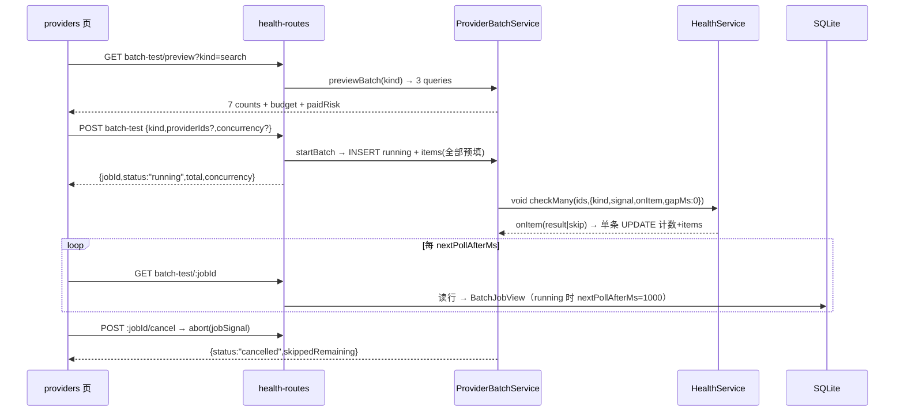

# v0.1.10 Stable 增量设计 — 搜索源一键体检中心

基线 `main@63dc2ed`；迁移 `0008_provider_test_batches`；语言 中文（UI 中英同批）。本设计只新增"批量任务台账 + 预检 + 收敛单源探测"，不改搜索主链路、预算/冷却算法与健康事实表。

## 1. 实现方案

**执行模型（单进程、DB 即真相）。** `POST /api/admin/provider-health/batch-test` 在事务里插入一行 `provider_test_batches(status='running')`，把**范围内全部来源**预填进 `items_json`（跳过项在创建时即写成 `skipped`+code，可探测项写成 `unknown`），立即返回 `jobId`；随后 `void runner.run(job)` 以 fire-and-forget 方式推进，HTTP handler 不 await。进度**不存内存**：每完成一条就 `UPDATE ... SET done/ok_count/... , items_json=完整数组` 一次（单进程只有一个写者，无丢更新）。`GET` 只读该行拼出 `BatchJobView`，因此重启后天然还能读到"最后写下的进度"。启动钩子 `ProviderBatchService.sweepInterrupted()` 在 `index.ts` 里 `startScheduler` 之前执行一条幂等 SQL（`WHERE status='running'`，第二遍匹配 0 行），把残留 running 改成 `interrupted`+`finished_at`，之后才接受新任务——**重启后永不报 `completed`**。

**取消语义。** 每个**任务**一个 `AbortController`（不是每源一个：取消是任务级决定，且 per-source 控制器无法停止队列）；它通过 `checkMany` 的 `signal` 传到 `checkOne` 的 `signal`，与每源自身的超时控制器用 `AbortSignal.any([jobSignal, timeoutSignal])` 合并后交给适配器。取消分三类落账：① 已完成条目保持不可变（结论仍可读，T13）；② 已发出请求的在途条目被 abort → `state=skipped, code=SKIPPED_CANCELLED, checkId=null`，**不退款**（`ProbeBudget.release` 只在"证明没发出"时由 `checkOne` 的 `spent:false` 路径回退，取消路径一律不退，沿用 `health.ts:398-405` 既有裁决）；③ 未开始条目由 worker 循环在 `queue.shift()` 前看 `signal.aborted` 直接记 `SKIPPED_CANCELLED`，不再发请求。`POST :jobId/cancel` 只写 `status='cancelled'` 并返回 `skippedRemaining`，不等 runner 收尾。

**资格判定。** 新模块 `apps/api/src/services/provider-eligibility.ts`：`loadEligibilityFacts()` 恰好 3 条查询（providers / api_keys / provider_probe_state，按 id 集合 `inArray`），`decideEligibility()` 是纯函数（D2 顺序，命中即停），`previewBatch()` 汇总 7 个计数。**唯一入口的范围**：批量预检、创建、runner、前端展示全部读这一个模块，路由与 UI 不再写任何 if 链。单个来源的两个端点（`/provider-health/:id/probe`、`/providers/:id/test`）**不套预检**（见 D-3 裁决），它们的"结论一致性"由共用 `checkOne` 保证。

**`requests` 从哪来。** 不碰 6 个适配器签名：`SafeFetchInit` 已有 `onRequest(url)` 钩子（`packages/shared/src/types.ts:427`，由 `safe-fetch.ts:446` 在**每个物理请求**含重定向跳转前调用；`packages/core/src/engine/fanout.ts:231` 就是这么计数的）。`checkOne` 本次探测前包一层 `countedFetch`：`(url, init) => ctx.fetch(url, {...init, onRequest: (t) => { n += 1; init?.onRequest?.(t); }})`，把 `n` 写进 `detail_json.requests` 与返回体。计数是**物理请求数**（分页每页各算一次，T02 的 brave `targetResults:50,maxPages:3` 因此 ≥2）。凭据缺失/未发请求时 `requests = null`，UI 显示 `—`；**禁止**用 `ceil(limit/pageSize)` 或计划页数推算（D7）。

**`empty_results`。** 保持 `statusFor("empty_results") === "degraded"`（`health-classify.ts:111`）与历史行不动；"待确认"只是**批量视图**的桶：`itemState = cause === "empty_results" ? "pending" : ...`。同理 `bad_response` 对外映射 `invalid_response`、`config_incomplete` 映射 `configuration_error`，全部经一张固定映射表（`externalCodeFor(cause)`），不改枚举。

## 2. 新增/修改文件清单

| 路径 | 职责 |
|---|---|
| `packages/db/migrations/0008_provider_test_batches.sql` | 新增 batch 表 + `provider_health_checks.batch_id` + 索引 |
| `packages/db/src/schema.ts` | `providerTestBatches` 表定义；`providerHealthChecks.batchId` 列 |
| `packages/shared/src/schemas.ts` | `batchTestCreateSchema`（concurrency 1..4）、`batchTestPreviewQuerySchema` |
| `packages/shared/src/types.ts` | `ProviderTestResult` 增 `status/cause/errorCode/requests/kind/keyId/checkedAt` |
| `apps/api/src/services/provider-eligibility.ts` | 资格事实 bulk 读取 + 纯函数判定 + 预检汇总 |
| `apps/api/src/services/health.ts` | `requests` 计数、`signal` 透传、共享 `probeWithLock`、`checkMany.onItem` |
| `apps/api/src/services/provider-batch.ts` | 任务台账、runner、`getJob`/`cancel`/`sweepInterrupted` |
| `apps/api/src/routes/health-routes.ts` | 预检 / 创建 / 查进度 / 取消 4 个端点 |
| `apps/api/src/routes/provider-routes.ts` | `testProvider` 改为 `checkOne` 薄封装，删除自拼 config |
| `apps/api/src/context.ts`、`apps/api/src/index.ts` | 注入 `ctx.batch`；启动前 sweep、关闭时 abort 全部任务 |
| `apps/web/src/lib/api.ts`、`types.ts`、`hooks.ts` | 4 个 API 方法、批量类型、`usePolling` |
| `apps/web/src/components/provider-batch-test-dialog.tsx` | 预检确认框（6 行计数 + 预算 + paidRisk + 免 Key 开关） |
| `apps/web/src/components/provider-batch-test-progress.tsx` | 进度条 + 取消 |
| `apps/web/src/components/provider-batch-test-results.tsx` | 结果表：排序/筛选/只重测失败/只重测待确认 |
| `apps/web/src/components/provider-batch-test-detail.tsx` | 详情抽屉（脱敏 Key、样例 ≤3、requests 缺失显 `—`） |
| `apps/web/src/pages/providers/index.tsx` | 顶部两个"直接执行"按钮改为打开预检框；接线 4 个组件 |
| `apps/web/src/lib/i18n-zh.ts` / `i18n-en.ts` | 新增 `providers.batch.*` 键，两份键集合相等 |

## 3. 迁移 0008（完整 SQL）

```sql
-- Bulk provider test jobs (v0.1.10). Health facts stay in `provider_health_checks`;
-- this table only answers "how far did this run get".
ALTER TABLE "provider_health_checks" ADD COLUMN "batch_id" text;
--> statement-breakpoint
CREATE INDEX IF NOT EXISTS "idx_health_batch" ON "provider_health_checks" ("batch_id");
--> statement-breakpoint
CREATE TABLE IF NOT EXISTS "provider_test_batches" (
  "id" text PRIMARY KEY NOT NULL,
  "kind" text NOT NULL DEFAULT 'search',
  -- running | completed | partial | cancelled | interrupted
  "status" text NOT NULL DEFAULT 'running',
  "total" integer NOT NULL DEFAULT 0,
  "done" integer NOT NULL DEFAULT 0,
  "ok_count" integer NOT NULL DEFAULT 0,
  "failed_count" integer NOT NULL DEFAULT 0,
  "pending_count" integer NOT NULL DEFAULT 0,
  "skipped_count" integer NOT NULL DEFAULT 0,
  "concurrency" integer NOT NULL DEFAULT 2,
  "options_json" text NOT NULL DEFAULT '{}',
  -- [{providerId,name,state,code,latencyMs,resultCount,requests,checkId,reason}]
  "items_json" text NOT NULL DEFAULT '[]',
  "budget_json" text NOT NULL DEFAULT '{}',
  "created_by" text,
  "created_at" text NOT NULL,
  "started_at" text,
  "finished_at" text
);
--> statement-breakpoint
CREATE INDEX IF NOT EXISTS "idx_test_batches_status" ON "provider_test_batches" ("status", "created_at");
```

`schema.ts` 片段：

```ts
// in providerHealthChecks: batchId: text("batch_id"),
export const providerTestBatches = sqliteTable("provider_test_batches", {
  id: text("id").primaryKey(), kind: text("kind").notNull().default("search"),
  status: text("status").notNull().default("running"), total: integer("total").notNull().default(0),
  done: integer("done").notNull().default(0), okCount: integer("ok_count").notNull().default(0),
  failedCount: integer("failed_count").notNull().default(0), pendingCount: integer("pending_count").notNull().default(0),
  skippedCount: integer("skipped_count").notNull().default(0), concurrency: integer("concurrency").notNull().default(2),
  optionsJson: text("options_json").notNull().default("{}"), itemsJson: text("items_json").notNull().default("[]"),
  budgetJson: text("budget_json").notNull().default("{}"), createdBy: text("created_by"),
  createdAt: text("created_at").notNull(), startedAt: text("started_at"), finishedAt: text("finished_at"),
}, (t) => [index("idx_test_batches_status").on(t.status, t.createdAt)]);
```

启动清扫（运行时 SQL，非迁移）：`UPDATE "provider_test_batches" SET "status"='interrupted',"finished_at"=$now WHERE "status"='running'`。

## 4. 关键接口签名

```ts
// provider-eligibility.ts
export type EligibilityCode = "ELIGIBLE" | "SKIPPED_DISABLED" | "CONFIG_ERROR" | "SKIPPED_COOLDOWN"
  | "SKIPPED_BUDGET" | "SKIPPED_NO_KEY" | "SKIPPED_NO_ENABLED_KEY" | "SKIPPED_KEYLESS_BY_POLICY";
export type PreviewBucket = "eligible"|"noKey"|"noEnabledKey"|"configError"|"disabled"|"keylessSkipped"|"coolingSkipped";
export interface EligibilityFact { providerId: string; providerName: string; enabled: boolean; adapterMissing: boolean;
  requiresKey: boolean; keyTotal: number; keyEnabled: number; firstKeyDecryptable: boolean;
  cooldownUntil: string | null; nextProbeAt: string | null; }
export interface EligibilityContext { kind: "connect" | "search"; includeKeyless: boolean;
  paidProbesEnabled: boolean; remainingToday: number; remainingRun: number; nowMs: number; }
export interface EligibilityResult { providerId: string; providerName: string; code: EligibilityCode;
  enqueue: boolean;        // runner 是否发请求
  countable: boolean;      // 进成功率分母（§5：CONFIG_ERROR 进，其余 SKIPPED 不进）
  bucket: PreviewBucket; reason: string; }
export function loadEligibilityFacts(db: SearchHubDb, providerIds: string[] | null): EligibilityFact[]; // 3 queries
export function decideEligibility(fact: EligibilityFact, ctx: EligibilityContext): EligibilityResult;   // pure
export function previewBatch(facts: EligibilityFact[], ctx: EligibilityContext):
  { counts: Record<PreviewBucket, number>; eligibleIds: string[] };
```

```ts
// health.ts（增量）
checkOne(providerId: string, options?: { kind?; keyId?; trigger?; signal?: AbortSignal }): Promise<HealthCheckResult>
// HealthCheckResult 增 requests: number | null（写在 detailJson.requests）
checkMany(providerIds: string[] | null, options?: { kind?; trigger?; gapMs?; respectInFlight?;
  signal?: AbortSignal; onItem?: (item: BatchItemDraft) => void }): Promise<{...}>
// 共享去重：与 checkMany 的 `this.inFlight` 同一集合（health.ts:186）
private probeWithLock(id: string, o: ..., signal?: AbortSignal): Promise<HealthCheckResult | "already_running">

// provider-batch.ts
export type BatchState = "ok" | "failed" | "pending" | "skipped" | "unknown";
export interface BatchItem { providerId: string; providerName: string; state: BatchState; code: string;
  latencyMs: number | null; resultCount: number | null; requests: number | null; checkId: string | null; reason: string | null; }
export interface BatchCounts { total: number; done: number; ok: number; failed: number; pending: number; skipped: number; remaining: number; }
export interface BatchJobView { jobId: string; status: "running"|"completed"|"partial"|"cancelled"|"interrupted";
  counts: BatchCounts; items: BatchItem[]; budget: ReturnType<HealthService["budget"]>;
  startedAt: string | null; finishedAt: string | null; nextPollAfterMs: number | null; }
startBatch(input: { kind: HealthProbeKind; providerIds?: string[] | null; concurrency?: number; actor: string }): Promise<BatchJobView>;
getJob(jobId: string): BatchJobView;                        // 只读 DB，不依赖内存
cancelBatch(jobId: string): { jobId: string; status: "cancelled"; skippedRemaining: number };
sweepInterrupted(now?: number): number;                     // 幂等，返回受影响行数
```

取值域（硬约束，进测试）：`state ∈ {ok,failed,pending,skipped,unknown}`；`code` = 12 个规范名（`ok/auth_invalid/forbidden/rate_limited/quota_exceeded/timeout/dns_error/tls_error/network_error/invalid_response/empty_results/configuration_error/server_error`）+ `SKIPPED_DISABLED|SKIPPED_BUDGET|SKIPPED_COOLDOWN|SKIPPED_NO_KEY|SKIPPED_NO_ENABLED_KEY|SKIPPED_KEYLESS_BY_POLICY|SKIPPED_CANCELLED|already_running|unknown`。恒等式：`done+skipped+remaining===total` 且 `ok+failed+pending===done`；映射：`ok→ok`、`empty_results→pending`、其余非跳过 cause→failed、跳过码→skipped。

## 5. 调用流程



## 6. 任务列表（6 个可独立提交的批次）

| 批次 | 涉及文件 | 验收命令 | T |
|---|---|---|---|
| **B1 数据与契约** | `0008_...sql`、`packages/db/src/schema.ts`、`packages/shared/src/schemas.ts`、`packages/shared/src/types.ts` | `pnpm vitest run tests/unit/batch-migration.test.ts tests/unit/migrate-guard.test.ts` + `pnpm typecheck` | — |
| **B2 判定与探测内核** | `provider-eligibility.ts`、`health.ts`、`tests/unit/provider-eligibility.test.ts`、`tests/integration/health.test.ts`(改动) | `pnpm vitest run tests/unit/provider-eligibility.test.ts tests/integration/health.test.ts tests/integration/health-e2e.test.ts` | 同 T05/T09/T20 的单元部分 |
| **B3 批量任务** | `provider-batch.ts`、`routes/health-routes.ts`、`context.ts`、`index.ts`、`tests/integration/provider-batch-run.test.ts`、`tests/integration/provider-batch-preview.test.ts` | `pnpm vitest run tests/integration/provider-batch-preview.test.ts tests/integration/provider-batch-run.test.ts` | T05–T19、T20–T24 |
| **B4 单源收敛** | `routes/provider-routes.ts`、`tests/integration/provider-single-test.test.ts` | `pnpm vitest run tests/integration/provider-single-test.test.ts tests/integration/health.test.ts` | T01–T04 |
| **B5 前端数据层与文案** | `web/lib/api.ts`、`web/lib/types.ts`、`web/lib/hooks.ts`、`i18n-zh.ts`、`i18n-en.ts` | `pnpm vitest run tests/unit/i18n-parity.test.ts` + `pnpm typecheck` | T30（静态部分） |
| **B6 前端界面与 E2E** | 4 个 `provider-batch-test-*.tsx`、`pages/providers/index.tsx`、`tests/e2e/provider-batch.spec.ts` | `pnpm test:e2e -- provider-batch` + `pnpm lint` | T25–T30 |

依赖：B1 → B2 → B3；B2 → B4（B4 与 B3 可并行）；B1/B2 → B5 → B6。

## 7. 测试清单

| T | 文件 | 用例名 | 关键断言 | stub/inject |
|---|---|---|---|---|
| T01 | `tests/integration/provider-single-test.test.ts` | `only CheckOne builds a probe config` | `POST /providers/:id/test` 后 `provider_health_checks` 恰 1 行；全仓 `rg "adapter.search" apps/api/src/routes` 为 0 命中 | inject |
| T02 | 同上 | `paginated probe issues more than one upstream request` | brave stub + `searchConfig{targetResults:50,maxPages:3}`：`stub.hits() >= 2`，`detail_json.requests >= 2` | stub |
| T03 | 同上 | `single test equals checkOne` | 同 stub 下 `:id/test` 与 `checkOne` 的 `resultCount`、`cause`、`requests` 相等 | stub |
| T04 | 同上 | `keeps legacy fields and adds new ones` | 5 个旧字段类型不变；新 5 字段存在；响应体不含 Key 明文（用 `redaction` 断言） | inject |
| T05 | `tests/unit/provider-eligibility.test.ts` | `decides 20 providers into 12/5/3` | `eligible=12,noKey+noEnabledKey=5,disabled=3` | inject |
| T06 | `tests/integration/provider-batch-preview.test.ts` | `connect preview ignores paid budget` | `kind=connect` → `paidRisk=false`、`coolingSkipped` 只反映冷却 | inject |
| T07 | 同上 | `paid disabled blocks preview and create` | `paidProbesEnabled=false` → `paidRisk=false`；`POST batch-test kind=search` → 409 `validation_error` | inject |
| T08 | 同上 | `preview writes nothing` | 前后 `provider_health_checks` 行数相等、`provider_test_batches` 行数相等 | inject |
| T09 | `tests/unit/provider-eligibility.test.ts` | `counts sum to total` | 7 个 bucket 之和 === `total`（budget/cooldown 均落 `coolingSkipped`） | inject |
| T10 | `tests/integration/provider-batch-run.test.ts` | `create returns jobId running` | 202 体 `jobId` 非空、`status=running`、`concurrency` 回显 | stub |
| T11 | 同上 | `partial results readable while running` | runner 未完成时 `GET` 的 `items` 含 `state=ok` 条目及其 `checkId` | stub（延迟 200ms） |
| T12 | 同上 | `counts monotonic` | 连续 5 次 `GET` 的 `done` 不减；每次 `done+skipped<=total` | stub |
| T13 | 同上 | `cancel keeps finished items` | 取消后 `status=cancelled`；取消前 `ok` 条目仍在且 `checkId` 非空；未开始条目 `SKIPPED_CANCELLED` | stub |
| T14 | 同上 | `restart marks interrupted` | 用同一 `dbPath` 新建 `createContext` 后 `GET` → `status=interrupted`，且 `!== "completed"`；未完成条目 `state=unknown` | inject（第二 ctx） |
| T15 | 同上 | `startup sweep is idempotent` | 连调 `sweepInterrupted()` 两次：第二次返回 0，行数/`status`/`finishedAt` 不变 | inject |
| T16 | 同上 | `in-flight never exceeds concurrency` | 20 源 + stub 记录并发峰值（`maxConcurrent<=2`，`concurrency=4` 时 `<=4`） | stub |
| T17 | 同上 | `concurrency 5 rejected` | `POST` 体 `concurrency:5` → 400 `validation_error`；`==4` 通过 | stub |
| T18 | 同上 | `second job skips already_running` | 两任务同源：第二个该源 `code=already_running`、`checkId=null`、stub 该 URL 命中数不增 | stub（每请求 300ms） |
| T19 | 同上 | `budget exhaustion skips remainder` | `maxRequestsPerDay` 剩 1：其余条目 `state=skipped`、`code=SKIPPED_BUDGET`、`reason` 含 `budget_exhausted`；ledger 未超限 | stub |
| T20 | `tests/unit/provider-eligibility.test.ts` | `success denominator is testable` | 20/12/5/3 场景：`testable=12`（`skipped=8` 不进分母），`CONFIG_ERROR` 进分母 | inject |
| T21 | `tests/integration/provider-batch-run.test.ts` | `empty results become pending` | 上游 200 且 0 条：`state=pending`、`code=empty_results`；`ok` 不增、`failed` 不增、`done` +1 | stub |
| T22 | 同上 | `decrypt failure is configuration_error` | 坏密文：`failed`+1、`code=configuration_error`、响应/`items_json` 无密文片段（正则扫 `keyCiphertext` 前缀） | inject |
| T23 | 同上 | `invalid response is failed` | 200 + `{"unexpected":true}`：`state=failed`、`code=invalid_response`、`ok=false` | stub |
| T24 | 同上 | `running shows partial completion` | `status=running` 且 `done+skipped<total` → 视图 `partialLabel` 用 `{done+skipped}/{total}`，`completed` 文案不出现 | stub |
| T25 | `tests/e2e/provider-batch.spec.ts` | `preview dialog shows six counts and paid risk` | 复用 `admin.spec.ts` 的 `completeSetup`/`login`/`addMockProvider`；预检框 6 个计数 + 预算 + `paidRisk` 提示可见 | inject（mock adapter） |
| T26 | 同上 | `confirm cancel keeps finished rows` | 确认→进度→取消→结果表仍有已完成行、状态含"部分完成" | inject |
| T27 | 同上 | `results sorted by severity` | 行序 失败→受限→待确认→成功→跳过（按 `data-state` 断言） | inject |
| T28 | 同上 | `retry failed submits failure set only` | 点击后请求体 `providerIds` 只含 failed 集合（拦截 `request` 断言） | inject |
| T29 | 同上 | `drawer redacts key and caps samples` | 抽屉显示 `key_ab…9f` 形态标签；样例 ≤3；`requests=null` 显示 `—` | inject |
| T30 | `tests/unit/i18n-parity.test.ts` + 同文件新用例 | `batch keys parity and no CJK literals` | `zh`/`en` 键集合相等；4 个新组件源码中不存在 CJK 字面量 | inject |

**测试口径说明**：`stub` = `tests/helpers/vendor-stubs.ts` 的真实 HTTP 回环（`startBraveStub`/`startHnStub`/`createProvider`/`addKey`），用于"探测是否真的按分页发请求、并发峰值、200/0 条"；`inject` = 直接种 DB + 注入时钟/跳过网（`clock:{now}`、坏密文、`paidProbesEnabled`），用于"资格判定、重启、预算、取消"。所有断言读库，不只读 HTTP 200。E2E 复用 `tests/e2e/admin.spec.ts` 的常量（`EMAIL`/`PASSWORD`）、`completeSetup`、`login`、`raiseLoginThrottle`、`addMockProvider("e2e-batch-a","a")`，并在 `test.beforeEach` 里只登录一次、直接 `page.goto("/providers")` 切到"健康"tab。

## 8. 风险

| # | 风险 | 缓解 |
|---|---|---|
| R1 | runner 与 `checkMany` 各自维护去重集合 → 同源重复付费 | 只保留 `HealthService.inFlight`（`health.ts:186`），新增 `probeWithLock` 同时服务 `checkMany` 与批量（替换原 615–646 的内联 add/delete），任何路径重复命中返回 `already_running` |
| R2 | 取消与超时竞态：abort reason 若含 `aborted` 会被 `classifyError` 判成 `timeout` 并写健康行（`health-classify.ts:324`） | 取消时 abort 的 reason 带 `code:"cancelled"`（走 `classifyError` 的 code 分支）；runner 侧再加兜底：任务 `status=cancelled` 且 cause∈{cancelled,timeout} 时按 `SKIPPED_CANCELLED` 落账并不接受健康行 |
| R3 | 每次完成写整份 `items_json`，200 源时 UPDATE 变宽 | 上限由 `providerIds.max(200)` 约束；单行 <64KB；实测写在 `items` 超过 200 时截断为 `[]` 并只依赖计数（文档注明） |
| R4 | `:id/test` 默认改 `search` 后，`paidProbesEnabled=false` 的环境由"能测"变 409 | 视为有意的安全收紧（PRD §8.1）；`/keys/:keyId/test` 保持 `kind=connect`（见 D-4），前端"测试"按钮显式传 `kind`，文案提示预算 |
| R5 | 进程被 kill 时 `finished_at` 由 sweep 补写，时间点不精确 | 只写"被中断的启动时刻"（`now`），并在 UI 显示"部分完成"，不假装知道真实结束时间 |
| R6 | 适配器把 `SearchHubError` 包装成 `ProviderError` 导致分类丢失 | `callJson` 已先判本地错误（`packages/providers/src/http.ts:71-95`）；T22 断言坏密文得到 `configuration_error` 而非 `network` |

## 9. 裁决（PRD 内部矛盾与留白）

- **D-1 裁决**：§8.2 预检把 `coolingSkipped` 单列，但 §5 同时有 `SKIPPED_BUDGET` 与 `SKIPPED_COOLDOWN`，7 计数无法与 `total` 相等（与 T09 冲突）。裁定：`coolingSkipped` 桶吸收"冷却 + 预算耗尽"两类，`items.code` 仍区分两者。
- **D-2 裁决**：PRD T14/T15 标 `P7`，需求池只有 P1–P6。归入 **P3（批量任务与重启恢复）**，因为 T14/T15 断言的正是 P3 的"重启只能 interrupted"。
- **D-3 裁决**：资格判定**不**作为单源入口的守门人。`/provider-health/:id/probe` 与 `/providers/:id/test` 保持现有 409/429 语义并允许对已禁用源做诊断探测；若套预检，会改变已测断言且让"先诊断后启用"不可行。US6 的一致性由共用 `checkOne` 保证。
- **D-4 裁决**：`:id/test` 默认 `kind=search`（PRD D1）且受预算约束；`/keys/:keyId/test` 默认 `kind=connect`（其语义一直是"这把 Key 能不能用"，不是"分页链路对不对"）。
- **D-5 裁决**：`partial` 只是防御性状态（runner 自然结束时要么 `completed`，要么 `cancelled`）；只有 `remaining>0` 的异常收尾才写它，UI 不依赖它表达"部分完成"。
- **D-6 裁决**：`requests` = 物理请求数（含重定向与分页），来自 `ctx.fetch` 的 `onRequest` 计数；未发出（无凭据/提前拒绝）为 `null`，**禁止**用计划页数推算（D7）。
- **D-7 裁决**：`empty_results` 的存储 status 保持 `degraded`，`pending` 仅存在于批量视图 `state`，`statusFor` 一行不改（不改历史行为）。
